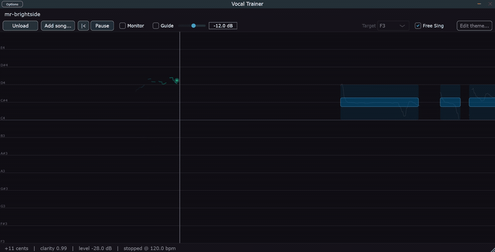

# Vocal Trainer

A Rock Band-style vocal trainer for singers. It shows your sung pitch against the notes of a
song, in real time, so you can see *where* you are flat or sharp rather than just being told
that you are.



Blue bars are the target notes and the bright one at the now-line is the note due right now.
The green trace is the live sung pitch, and the faint grey line behind it is the reference
contour the chart was built from. Bottom left reads out cents, clarity and input level.
*(The lyric strip is spliced out of this capture.)*

Two halves:

- **The plugin** (C++ / JUCE 9) — a zero-latency audio effect that sits on the mic track.
  Builds as a **Standalone** app and as a **VST3** for Ableton Live 11. It reads the mic,
  runs a hand-rolled MPM / NSDF pitch detector on a 16 kHz analysis stream, and draws a live
  pitch trace on a note highway.
- **The offline pipeline** (Python) — pre-analyses a song into a `chart.json` note chart:
  vocal separation, pitch tracking, note segmentation, lyric alignment, syllabification.

Design doc: [`docs/DESIGN.md`](docs/DESIGN.md). It holds the exact numbers — filter corners,
window sizes, thresholds, colours, geometry. Read the sections relevant to your files before
writing code.

**This project's own source is MIT** ([`LICENSE`](LICENSE)). It does **not** ship JUCE — you
clone that yourself and accept its licence directly, which matters more than it sounds like:
see [Licence](#licence) below and [`THIRD-PARTY.md`](THIRD-PARTY.md).

Contributing a dependency? Read [`LICENSING.md`](LICENSING.md) first. The short version: zero
copyleft in the plugin binary, and there is a hard do-not-link list.

---

## Milestone status

| | | Status |
|---|---|---|
| **M0** | Validate the premise before writing code | done |
| **M1** | JUCE Standalone: mic in, live pitch out | **built, awaiting a human ear** |
| **M2** | Offline pipeline v1 → `chart.json` | **working end to end** |
| **M3** | Note highway + full-song practice in the Standalone | **feature-complete, unvalidated by eye** |
| **M3.5** | Stage 0 separation + **Add song...** from any audio file | **working end to end** |
| M4 | VST3 target + Ableton sync + calibration | not started |
| M5 | Lyrics end to end | not started |
| M6 | Scoring, post-take review, feedback fading | not started |

---

## Building the plugin (Windows 11, VS Build Tools 2022, no full IDE)

**Windows only, currently.** Nothing in the code is Windows-specific by design, but no other
platform has been built or tested — treat macOS and Linux as unknown rather than supported.

The machine this was developed on has no Visual Studio IDE and no standalone CMake on `PATH`,
so the commands below use the CMake bundled with the Build Tools. If you have `cmake` and a
compiler on `PATH` already, plain `cmake` works and you can skip the `vcvars64.bat` step.

### One-time

JUCE 9.0.0 must be present as a **plain directory** at `./JUCE` (it is *not* a git submodule,
and it is gitignored). From the repo root:

```powershell
git clone --depth 1 --branch 9.0.0 https://github.com/juce-framework/JUCE.git JUCE
```

**You must also have a juce.com account and have accepted the JUCE 9 EULA** to use the free
Starter tier. An unregistered clone is AGPLv3, and that applies to whatever you build from it
regardless of this project's MIT licence. See [`THIRD-PARTY.md`](THIRD-PARTY.md).

### Configure and build

Open a plain PowerShell prompt in the repo root, then:

```powershell
# 1. Bring the MSVC toolchain into the environment (this is why we shell out to cmd)
cmd /c '"C:\Program Files (x86)\Microsoft Visual Studio\2022\BuildTools\VC\Auxiliary\Build\vcvars64.bat" && powershell'

# 2. Configure (Release)
& "C:\Program Files (x86)\Microsoft Visual Studio\2022\BuildTools\Common7\IDE\CommonExtensions\Microsoft\CMake\CMake\bin\cmake.exe" `
    -S . -B build -G Ninja -DCMAKE_BUILD_TYPE=Release

# 3. Build everything
& "C:\Program Files (x86)\Microsoft Visual Studio\2022\BuildTools\Common7\IDE\CommonExtensions\Microsoft\CMake\CMake\bin\cmake.exe" `
    --build build
```

With CMake already on `PATH`, that is just:

```powershell
cmake -S . -B build -G Ninja -DCMAKE_BUILD_TYPE=Release
cmake --build build
```

Build a single target instead of everything with `--target VocalTrainer_Standalone`,
`--target VocalTrainer_VST3`, or `--target vt_tests`.

For a Debug build use `-DCMAKE_BUILD_TYPE=Debug` and a separate build directory
(`build-debug`) — Ninja is single-config, so reusing one directory for both forces a full
reconfigure each time.

### Running the Standalone

```
build\VocalTrainer_artefacts\Release\Standalone\Vocal Trainer.exe
```

On first launch, open the Standalone's own **Options → Audio/MIDI Settings** and pick the
input device and the mic channel. The Standalone owns the audio device; the VST3 does not.

### Running the tests

```
build\vt_tests_artefacts\Release\vt_tests.exe
build\vt_chart_tests_artefacts\Release\vt_chart_tests.exe
build\vt_render_tests_artefacts\Release\vt_render_tests.exe
build\vt_backing_tests_artefacts\Release\vt_backing_tests.exe
```

`vt_tests` covers the DSP core (12 cases). `vt_chart_tests` covers chart parsing, the
time queries and octave folding (41 checks) — and it parses the REAL
`songs/synth-demo/chart.json`, so a schema drift between the Python writer and the C++
reader fails there rather than on stage. Build a chart first or those checks skip.
`vt_render_tests` renders components offscreen and counts pixels, which is the only thing
that catches "it computes correctly but you cannot see it".

`vt_backing_tests` covers the `BackingPlayer` lifecycle. **It is the one test that crashes
rather than fails when it catches its bug** — JUCE's resampler takes an integer divide by
zero if the audio thread pulls it after `releaseResources()`, and a hardware fault cannot be
turned into a failed assertion. Exit code `0xC0000094` from that runner means the guard in
`BackingPlayer::renderInto` has been lost. See DESIGN.md §11.12.

Python side:

```
cd python && ..\.venv\Scripts\python.exe -m pytest tests -q
```

Disable the C++ test targets entirely with `-DVT_BUILD_TESTS=OFF`.

### Adding a song from an audio file (M3.5)

Click **Add song...**, pick any audio file, and wait. The plugin runs the whole
offline pipeline for you — vocal/instrumental separation, pitch tracking, note
segmentation, lyric transcription — then loads the finished chart.

A progress panel covers the highway with the current stage and an overall
percentage; **Cancel** stops it cleanly at the next stage boundary. Roughly 3–5
minutes for a 4-minute song on this machine's RTX 3080 Ti (the first ever run
also downloads a 610 MB separation model).

The button is **Standalone-only** and deliberately so. Separation is minutes of
GPU work, and starting it from inside Live — which owns the audio device and
expects prompt returns — would make Live look hung. Preparing songs is a
before-you-play activity.

Video containers (`.mp4`, `.mkv`, …) work too; ffmpeg demuxes them first.

The equivalent from a prompt, which also takes the options the button does not:

```bash
vocalchart add-song "D:\music\Mr Brightside.mp3" --lyrics brightside.txt
```

**Pass `--lyrics` whenever you have the text.** It is the single largest quality
difference available in the whole pipeline: known lyrics turn a 20–38% word
error transcription problem into a pure timing problem. Without it the chart
still gets words, but they will be wrong often enough to notice.

### Practising against a chart (M3)

1. Build a chart for a song — **Add song...**, `add-song`, or `import-stems`.
2. Launch the Standalone, click **Load chart...**, pick `songs/<id>/chart.json`.
   (A song added with **Add song...** loads itself when it finishes.)
3. Press **Play**. The backing track plays, the highway scrolls; sing.

Try it immediately with the bundled demo: `songs/synth-demo/chart.json`.

**Wear headphones.** If you practise on speakers, the mic hears the backing track and the
tracker follows the record instead of you. That is the single most likely cause of
"the pitch detection is broken" that is not actually a bug.

**The clock follows what you hear.** When a backing track is loaded, its playback position
*is* chart time. With no backing track the clock falls back to the audio-stream position —
estimates arrive at a steady 125 Hz even during silence, so the stream is drift-free and is
already the timebase those estimates are stamped in. Either way the highway can never drift
against the audio.

Backing playback is **Standalone only**. In the VST3, Ableton owns playback, and a plugin
that also played the backing track would double it. The mix happens strictly *after* the
analysis chain reads the mic, so the backing track can never leak into the pitch detector.

Two things the highway does deliberately, which can look like bugs:

- **The target bar gets taller when you loosen the tolerance.** Its drawn height *is* the
  full-credit window (2 x `tFullCents`), so "inside the bar" means "full marks", with
  nothing to translate in your head.
- **Singing an octave off still puts the trace on the bar**, with a `-1 8ve` badge.
  Scoring is octave-agnostic, so the display folds the same way. If it did not, a bass
  singing a soprano line would see full marks with the trace nowhere near the bar, and
  would stop trusting the feedback.

Every geometry and colour constant lives in `%APPDATA%\VocalTrainer\theme.json` and
hot-reloads within 250 ms — no rebuild needed to tune the look.

### Loading the VST3 in Ableton Live 11

Configure with `-DVT_COPY_PLUGIN_AFTER_BUILD=ON` and the built VST3 is copied to
`VT_VST3_COPY_DIR` after every build. That defaults to `%USERPROFILE%\VST3Dev` — a
user-writable folder, so builds never need admin elevation, unlike
`C:\Program Files\Common Files\VST3`. Override it with `-DVT_VST3_COPY_DIR=...`.

```powershell
cmake -S . -B build -G Ninja -DCMAKE_BUILD_TYPE=Release -DVT_COPY_PLUGIN_AFTER_BUILD=ON
```

Point Live at that same folder once: **Preferences → Plug-Ins → VST3 Plug-In Custom Folder**,
then **Rescan**. Live requires that this custom folder is *not* the system VST3 folder.

Also turn **OFF** Live's **"Auto-Scale Plug-In Window"**. It makes JUCE VST3 editors blurry
on Windows above 100% display scaling — a long-standing unresolved JUCE/Ableton interaction.

The plugin must go on an **audio track** carrying the mic signal, as an audio effect.

---

## Build options

| Option | Default | Effect |
|---|---|---|
| `VT_ENABLE_ASIO` | **OFF** | When ON, sets `JUCE_ASIO=1` and compiles ASIO support into the Standalone. **Do not distribute a binary built with this ON** — see below. |
| `VT_BUILD_TESTS` | ON | Builds the console test runners. |
| `VT_COPY_PLUGIN_AFTER_BUILD` | OFF | When ON, copies the built VST3 into `VT_VST3_COPY_DIR` after each build. |
| `VT_VST3_COPY_DIR` | `%USERPROFILE%\VST3Dev` | Where that copy goes. Must be user-writable, and must not be the system VST3 folder. |

### About `VT_ENABLE_ASIO`

Turning it **ON** gives the **Standalone** direct low-latency access to the Apollo Twin X
through its ASIO driver, instead of going through WASAPI. That is a real, audible improvement
for live monitoring, and it is the reason the option exists. The ASIO SDK is bundled with
JUCE 9 (since 8.0.11), so nothing needs to be downloaded — just reconfigure with
`-DVT_ENABLE_ASIO=ON`.

It defaults to **OFF** for two reasons:

1. **The first build on a clean machine must not fail on an SDK problem.** Off by default
   means configure-and-build works immediately, every time.
2. **Licensing.** The ASIO SDK is **GPLv3 or Steinberg-proprietary**. For a personal,
   undistributed tool this never matters — no distribution, no copyleft obligation. But
   **for any closed-source distribution it must stay OFF** (JUCE falls back to WASAPI), or
   you must obtain Steinberg's proprietary ASIO licence. See `LICENSING.md`.

**The VST3 target never needs ASIO** — inside Live, Live owns the audio device.

If you enable ASIO, note the startup order that this rig needs: Apollo powered and its
console running *before* Live or the Standalone.

---

## The offline pipeline

Python 3.11 venv at `.venv`, ONNX-only — `swift-f0` needs no `torch`, and **`torch` must not
be added as an M2 dependency**. `ffmpeg` must be on `PATH`.

```powershell
py -3.11 -m venv .venv
.venv\Scripts\Activate.ps1
python -m pip install -e python
```

### Commands

| | |
|---|---|
| `vocalchart add-song <audioFile>` | **everything**: one file in, a playable song folder out |
| `vocalchart import-stems <stemDir> <songDir>` | same, from a real multitrack — **better, when you have one** |
| `vocalchart separate <songDir>` | stage 0 only: `source.*` → `stems/vocals.wav` + `backing.wav` |
| `vocalchart f0 / notes / lyrics <songDir>` | stages 1 / 2 / 3 on their own |
| `vocalchart build <songDir>` | stages 0–5 over an existing song folder |
| `vocalchart inspect <songDir>` | human summary of what came out, with a pitch sparkline |

Every stage caches; `--force` recomputes, `-v` narrates.

### The separation venv (`.venv-separate`)

Stage 0 runs in a **second venv**, reached by subprocess. `audio-separator`
requires `torch >= 2.3`, and torch must not go anywhere near `.venv`: that one is
ONNX-only by design, and installing torch *after* `faster-whisper` is exactly
what produces the `cudnn_ops64_9.dll` failure DESIGN.md:375 warns about.

One-time setup:

```powershell
py -3.11 -m venv .venv-separate
.venv-separate\Scripts\python.exe -m pip install `
    torch==2.8.0 torchaudio==2.8.0 torchvision==0.23.0 `
    --index-url https://download.pytorch.org/whl/cu126
.venv-separate\Scripts\python.exe -m pip install `
    "audio-separator[gpu]==0.44.5"
```

Three things about that recipe are load-bearing:

- **`cu126`, not the `cu124` in DESIGN.md.** The cu124 index stopped carrying
  torch after 2.6; 2.8.0 is only on cu126 and cu128.
- **`torchvision` is pinned and installed alongside torch.** `audio-separator`
  depends on `onnx2torch`, which depends on `torchvision`. Leave it out and pip
  resolves torchvision to its newest release, which drags in a **CPU-only**
  torch over the CUDA one you just installed — silently, with only a dependency
  warning. Separation still works; it just takes 20–40 minutes instead of 2.
  Check with `python -c "import torch; print(torch.cuda.is_available())"`.
- **Re-run the torch install last if you ever add packages to this venv**, for
  the same reason.

No NVIDIA GPU? Use `/whl/cpu` and `audio-separator[cpu]`; everything works, just
slowly. Point `VOCALCHART_SEPARATOR_PYTHON` at a different interpreter to
override discovery, and `VOCALCHART_SEPARATOR_MODELS` to move the 610 MB model
cache out of `%LOCALAPPDATA%\VocalTrainer\separator-models`.

### Separation quality, measured here

Mixing a known vocal stem back over its own backing track and separating it
again recovers the vocal at **16.9 dB** scale-invariant SDR, and — the number
that actually matters, since this feeds a pitch chart — the pitch track off the
separated stem matches the ground-truth stem to **0.0 cents median, 99.4% of
frames within 50 cents**. Warm separation of a 30 s clip takes 16 s on the
RTX 3080 Ti.

That is good, and it still does not make separation the preferred path. A
**genuine isolated stem** drops downstream word error to 14.19% against 21.08%
for a separated one (DESIGN.md section 4) — the artifacts that survive
separation hurt the lyrics far more than they hurt the pitch. Use
`import-stems` when you have real multitracks; use `add-song` for everything
else.

---

## Repository layout

```
CMakeLists.txt        build configuration for the plugin + tests
docs/DESIGN.md        the full design document — the source of truth for all numbers
LICENSE               MIT — this project's own source
THIRD-PARTY.md        attribution for everything we depend on, and what you may redistribute
LICENSING.md          licence decisions and the do-not-link list (read before adding a dep)
songs/synth-demo/     the one bundled song — synthesised, no third-party rights
src/                  C++ plugin source (namespace vt)
  PluginProcessor.cpp   audio thread, transport, lock-free queues
  PluginEditor.cpp      editor shell
  dsp/AnalysisChain.cpp resample, condition, MPM pitch detection
  import/SongImporter.cpp  spawns the offline pipeline, parses its progress
  ui/Theme.cpp          Okabe-Ito colours, fonts, metrics
  ui/PitchLaneComponent.cpp   the pitch lane / live trace
  ui/ImportOverlayComponent.cpp  the "preparing your song" panel
tests/test_pitch.cpp  pitch detector tests (vt_tests console app)
JUCE/                 JUCE 9.0.0 clone — gitignored, not a submodule
.venv/                Python 3.11 venv for the offline pipeline — gitignored
.venv-separate/       Python 3.11 venv holding torch + audio-separator — gitignored
build/                CMake build tree — gitignored
```

---

## Licence

**MIT**, for everything in this repository. See [`LICENSE`](LICENSE).

Three caveats that MIT does not cover, in descending order of how likely they are to catch
you out. [`THIRD-PARTY.md`](THIRD-PARTY.md) has the full detail.

1. **JUCE is not ours to license to you.** It is gitignored, you clone it yourself, and JUCE 9
   is dual-licensed AGPLv3-or-commercial. This project is developed under JUCE's free
   **Starter** tier, which is perpetual and costs nothing but requires a juce.com account and
   acceptance of the EULA. **An unregistered clone is AGPLv3**, and so is anything you build
   from it — our MIT grant does not change that.

2. **Do not distribute a build made with `VT_ENABLE_ASIO=ON`.** The ASIO SDK is GPLv3 or
   Steinberg-proprietary. Off by default, and it stays off in anything released here.

3. **Charts you generate are derivative works of the songs they came from** — the aligned
   lyrics especially. `songs/` is gitignored for that reason. Keep them local. The one
   exception, `songs/synth-demo/`, is synthesised here and carries no third-party rights.

The separation model weights are also not redistributable. They download to
`%LOCALAPPDATA%\VocalTrainer\separator-models`, outside the repo, so they cannot be committed
by accident.
