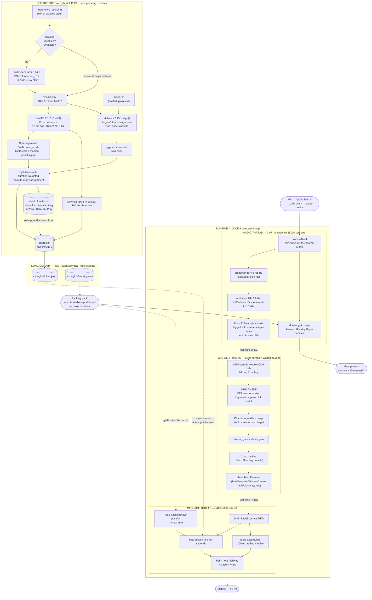

# Vocal Trainer — Architecture & Implementation Design

**Status:** Decided. Hand to engineering.
**Target:** Windows 11 Home, UAD Apollo Twin X (Thunderbolt), solo developer.
**Date:** 2026-08-01, revised 2026-08-06 (VST3 dropped — see below).

---

> ### 2026-08-06 — CHANGE OF DIRECTION: STANDALONE ONLY
>
> **The VST3 target has been dropped and the app is standalone only.** Milestone 4
> (VST3 + Ableton sync + calibration) is cancelled; it was never started.
>
> This document originally specified two targets sharing one codebase, and section 1
> below argued for exactly that. The objection it answers — "Ableton contributes only
> backing-track playback and mic capture, and a standalone app does both" — turned out
> to be the right call, and the standalone reached feature-complete before the VST3
> branch was begun. Everything the host was going to supply, the app now supplies
> itself: the backing track is a `juce::AudioTransportSource` it owns, and chart time
> comes from that transport rather than from a playhead.
>
> **Deleted outright:** `AudioPlayHead` handling, the transport seqlock
> (`TransportSnapshot` / `TransportSeqlock` are gone from `LockFreeTypes.h`), the five
> offset parameters, the "Capture playhead" anchor button, the calibration wizard, the
> Arrangement-View-only workflow constraint, and every Live window/DPI/rescan concern.
>
> **Unchanged:** everything else. The DSP chain, the chart format, the scoring, the
> highway geometry and the offline pipeline never depended on the host.
>
> Sections below are kept as the record of why decisions were made. Where a section
> describes VST3 mechanics, read it as history, not as instructions.

---

## 1. ARCHITECTURE

**One JUCE 9 C++ codebase built as a standalone desktop application** — it owns the audio
device, reads the mic, plays the backing track, and shares 100% of its DSP, chart, scoring
and rendering code with nothing else. The offline chart-generation pipeline is a completely
separate Python 3.11 CLI that never ships inside the app.

`juce_add_plugin(... FORMATS Standalone ...)` is how JUCE builds this: the plugin client's
standalone wrapper supplies the Audio/MIDI Settings dialog, remembers the chosen device, and
drives `processBlock` from the device callback. There is no plugin build.

### The reasons that still hold

1. **One artifact, one language, one clock, no IPC.** The pitch estimate produced on the audio thread and the note it is scored against live in the same address space, timestamped in the same sample domain. A web front end talking to a bridge process over WebSocket adds a serialisation boundary, a second runtime, a second install, and a clock you have to reconcile — for a GUI capability (2D scrolling, 60 fps) that JUCE 8+'s Direct2D renderer handles without breaking a sweat.

2. **The backing track is the clock, and it is exact.** Chart time is the transport's own position, read from the same `AudioTransportSource` that is producing the sound the singer is following. There is nothing to synchronise, because there is only one clock.

3. **No host in the loop at all.** No plugin rescan cycle, no Live window/DPI bugs, no Arrangement-View-only workflow constraint, and a ~2 s launch.

### The original transport argument, kept as history

The first version of this document justified the VST3 on transport sync: `juce::AudioPlayHead::getPosition()` hands you `timeInSamples` as an exact `int64` once per `processBlock`, and every way of getting song position *out* of Live is worse — Ableton Link *structurally cannot* carry song position (it synchronises "tempo, beat, and phase" across independent timelines — see https://ableton.github.io/link/ — it can never tell you "we are 97.4 seconds into the song"); AbletonOSC's `/live/song/start_listen/beat` fires **once per beat** (500 ms at 120 BPM — you would extrapolate 30 frames between samples); Windows MIDI clock jitters ~2.5 ms even with pro drivers and its Song Position Pointer wraps around bar 1025.

That analysis is still correct, and it is still the reason not to reach for Link, OSC or MIDI clock if the app ever needs to follow an external timeline. It stopped mattering because the app no longer needs song position from anywhere — it owns the transport.

The other original argument was that a plugin sees the post-UAD-chain mic signal with no device contention. The standalone gets the same signal by opening the Apollo directly; the trade is that startup order now matters (Apollo and its console up before the app), which is noted under `VT_ENABLE_ASIO` in the README.

### The second objection, and its answer

**C++ GUI iteration is slow, and game feel needs dozens of tweak-look-tweak cycles.** True, and it is the most likely cause of project abandonment. Two mitigations, both mandatory:

- A standalone app (~2 s launch, no host, no rescan).
- Put **every** tuning constant — scroll rate, lookahead seconds, tolerance thresholds, colours, easing curves, bar geometry, gate thresholds — in `%APPDATA%\VocalTrainer\theme.json`, hot-reloaded by a `juce::FileChooser`-free `juce::Timer` polling the file's modification time at 4 Hz. Tuning the look then requires **zero rebuilds**. Budget half a day to build this in Milestone 1; it pays for itself in the first week.

### Explicitly rejected, with reasons

| Rejected | Killer objection |
|---|---|
| **Max for Live** | M4L device height is hard-capped at **169 px** (https://docs.cycling74.com/userguide/m4l/live_userinterfaces/) — an embedded note highway is impossible, so you must spawn a `jit.world`/`jweb` window and inherit all standalone-app complexity *plus* Max's constraints. Compounded: Live 11 ships Max 8, whose `js` object is an ES3/ES5-era engine (V8 is Max 9 / Live 12 only); `jweb` cannot load HTML from a **frozen** device; Node-for-Max has acknowledged M4L problems; and it may require a Suite/M4L licence the user does not own. |
| **JUCE 8+ WebView UI (WebView2)** | Adds a DPI and window-lifecycle surface for nothing. Direct2D + `VBlankAttachment` is sufficient for a 2D highway. Keep as the escape hatch if Direct2D underperforms on this GPU. |
| **Pure browser + MIDI clock / Web MIDI** | Combines the worst clock (Windows MIDI clock jitter, SPP wraparound, Web MIDI's documented inability to do drift-corrected timing) with the worst input path (Chrome-on-Windows shared-mode WASAPI, measured 55–67 ms default input→output). |
| **Any plugin format (VST3, CLAP, VST2)** | Dropped 2026-08-06 — see the note at the top. A host buys nothing the app cannot do itself, and costs a rescan loop, a window/DPI surface, and a second clock to reconcile. |

---

## 2. SYSTEM DIAGRAM



---

## 3. CHART FILE FORMAT

### Decision: **seconds, not beats. Absolute, relative to the reference audio file's own timeline.**

Five reasons, in order of force:

1. **Provenance.** SwiftF0 emits seconds. stable-ts emits seconds. Converting to beats requires a tempo map that does not exist, which you would have to estimate — introducing an error source with no offsetting benefit.
2. **Live's PPQ is a function of a tempo map you do not control.** An unwarped audio clip plays at original speed while `ppqPosition` advances at *project* tempo. A beat-indexed chart silently desynchronises the moment the user edits the project BPM — a failure that only appears after a tempo edit and is therefore easy to miss in testing.
3. **Real singing is not metronomic.** A single global BPM misaligns by hundreds of milliseconds by the last chorus, and beat-indexing bakes that error in permanently.
4. **The pedagogical content is physical.** Cents, Hz, milliseconds of onset error, vibrato rate in Hz. Beats add a unit conversion to every comparison.
5. **The Live Object Model concedes the point** — unwarped audio clips report `playing_position` in seconds, warped ones in beats. Seconds is the unit that survives the "Warp off" workflow you actually want for a vocal reference.

An **optional** `tempoMap` is carried for bar-line rendering and future slow-down practice. It is advisory. Seconds are normative.

### JSON Schema

```jsonc
{
  "$schema": "https://vocaltrainer.local/schema/chart-1.0.json",
  "schemaVersion": "1.0",

  "generator": {
    "tool": "vocalchart",
    "version": "0.1.0",
    "pitchModel": "swift-f0 0.1.2",
    "lyricSource": "forced-alignment",     // "forced-alignment" | "asr" | "manual" | "none"
    "lyricModel": "stable-ts 2.19.1 / large-v3",
    "separator": "none",                    // "none" | "bs-roformer ep_317" | "htdemucs_ft"
    "generatedAt": "2026-08-01T14:22:10Z"
  },

  "song": {
    "id": "amazing-grace-demo",             // folder name; the ONLY thing stored in session state
    "title": "Amazing Grace",
    "artist": "Traditional",
    "durationSeconds": 168.400,
    "referenceAudio": "stems/vocals.wav",   // relative to chart.json
    "backingAudio": "backing.wav",          // relative; used by Standalone target
    "referenceAudioSha1": "3f1c9a...",      // detects a swapped/re-rendered stem
    "tuningHz": 440.0,                      // from librosa.estimate_tuning; NEVER assume 440
    "detectedKey": "G major",
    "vocalRangeMidi": { "min": 55, "max": 67 }
  },

  "timing": {
    "unit": "seconds",
    "epoch": "referenceAudioStart",         // chart t=0 == first sample of referenceAudio
    "arrangementAnchorSeconds": 8.000,      // HINT ONLY: arrangement time where chart t=0 sits.
                                            // Authoritative value lives in session state (APVTS).
                                            // null == not yet captured.
    "rateFactor": 1.0,                      // 1.0 = unwarped. projectBPM/chartBPM if warped.
    "tempoMap": [                           // OPTIONAL, advisory, bar lines only
      { "timeSeconds": 0.000, "bpm": 68.0, "timeSignature": [3, 4] }
    ]
  },

  "phrases": [
    {
      "id": 0,
      "startSeconds": 2.140,
      "endSeconds": 8.910,
      "text": "Amazing grace how sweet the sound",
      "noteIds": [0, 1, 2, 3, 4, 5]
    }
  ],

  "notes": [
    {
      "id": 0,
      "startSeconds": 2.140,
      "durationSeconds": 0.940,
      "midi": 55,                           // integer, snapped, A4 = tuningHz
      "centsOffset": -12.4,                 // reference singer's actual deviation from `midi`
      "type": "normal",                     // "normal"|"golden"|"freestyle"|"rap"|"breath"
      "syllable": "A",
      "syllableRole": "wordStart",          // "wordStart"|"continuation"|"melisma"|"none"
      "phraseId": 0,
      "confidence": 0.94                    // mean SwiftF0 confidence over the note
    }
  ],

  "contour": {                              // reference singer's raw f0 — the "ghost line"
    "rateHz": 100.0,
    "startSeconds": 0.000,
    "fracMidi": [55.02, 55.06, 54.98, null, 60.11, "..."],   // null == unvoiced
    "confidence": [0.94, 0.95, 0.93, 0.10, 0.97, "..."]
  },

  "warnings": [
    { "code": "LOW_CONFIDENCE_REGION", "startSeconds": 41.2, "endSeconds": 43.8,
      "message": "Mean f0 confidence 0.34 — likely breathy or backing-vocal contamination." }
  ]
}
```

### Field notes for the implementer

- **`notes[].type`**: `freestyle` and `breath` are scored as always-hit (they exist so the highway shows *something* where the singer must breathe or where Whisper deleted a non-lexical vocable like "oh"). `rap` ignores pitch entirely. `golden` maps from UltraStar `*` and is currently a 2× score multiplier and nothing else.
- **`syllableRole`**: `melisma` means "same syllable continues onto this new note" — render a tie glyph (‿) and no new text. This is required because one syllable frequently spans several note events.
- **A note may have `syllable: null`.** Whisper systematically deletes non-lexical vocables and backing vocals regardless of separation quality (arXiv:2506.15514). The word→note assignment **must** tolerate notes with no syllable rather than crashing or dropping the note. These are exactly the sustained held notes a vocal highway most wants to show.
- **`contour` is the single best hedge in this format.** It sidesteps the entire "did I segment that portamento correctly" problem for the part of the UI where it matters most — render it as a faint ghost line behind the discrete note bars, and the user sees the reference singer's actual scoop and vibrato even where segmentation was ambiguous. Cost: ~17 KB per minute as JSON floats.
- **Only `song.id` goes into the plugin's `AudioProcessorValueTreeState`.** The library root path lives in a `juce::PropertiesFile` under `File::getSpecialLocation(File::userApplicationDataDirectory).getChildFile("VocalTrainer")`. Absolute paths in plugin state get serialised into the `.als` and break permanently when the library moves.

### Worked example — 6 notes with syllables

`%APPDATA%\VocalTrainer\songs\amazing-grace-demo\chart.json` (abridged to the first phrase):

```json
{
  "schemaVersion": "1.0",
  "generator": {
    "tool": "vocalchart", "version": "0.1.0",
    "pitchModel": "swift-f0 0.1.2",
    "lyricSource": "forced-alignment",
    "lyricModel": "stable-ts 2.19.1 / large-v3",
    "separator": "none",
    "generatedAt": "2026-08-01T14:22:10Z"
  },
  "song": {
    "id": "amazing-grace-demo",
    "title": "Amazing Grace",
    "artist": "Traditional",
    "durationSeconds": 168.400,
    "referenceAudio": "stems/vocals.wav",
    "backingAudio": "backing.wav",
    "referenceAudioSha1": "3f1c9a7e2b04d6f1a8c35e9017bb4426d1f0a9c2",
    "tuningHz": 440.0,
    "detectedKey": "G major",
    "vocalRangeMidi": { "min": 55, "max": 67 }
  },
  "timing": {
    "unit": "seconds",
    "epoch": "referenceAudioStart",
    "arrangementAnchorSeconds": null,
    "rateFactor": 1.0,
    "tempoMap": [ { "timeSeconds": 0.0, "bpm": 68.0, "timeSignature": [3, 4] } ]
  },
  "phrases": [
    {
      "id": 0,
      "startSeconds": 2.140,
      "endSeconds": 8.912,
      "text": "Amazing grace how sweet the sound",
      "noteIds": [0, 1, 2, 3, 4, 5, 6]
    }
  ],
  "notes": [
    { "id": 0, "startSeconds": 2.140, "durationSeconds": 0.882, "midi": 55,
      "centsOffset": -12.4, "type": "normal", "syllable": "A",
      "syllableRole": "wordStart", "phraseId": 0, "confidence": 0.94 },

    { "id": 1, "startSeconds": 3.022, "durationSeconds": 1.764, "midi": 60,
      "centsOffset": 4.1, "type": "normal", "syllable": "ma",
      "syllableRole": "continuation", "phraseId": 0, "confidence": 0.97 },

    { "id": 2, "startSeconds": 4.786, "durationSeconds": 0.441, "midi": 64,
      "centsOffset": -3.8, "type": "normal", "syllable": "zing",
      "syllableRole": "continuation", "phraseId": 0, "confidence": 0.96 },

    { "id": 3, "startSeconds": 5.227, "durationSeconds": 0.441, "midi": 60,
      "centsOffset": 8.9, "type": "normal", "syllable": null,
      "syllableRole": "melisma", "phraseId": 0, "confidence": 0.91 },

    { "id": 4, "startSeconds": 5.668, "durationSeconds": 1.323, "midi": 60,
      "centsOffset": 1.2, "type": "normal", "syllable": "grace",
      "syllableRole": "wordStart", "phraseId": 0, "confidence": 0.98 },

    { "id": 5, "startSeconds": 6.991, "durationSeconds": 0.882, "midi": 64,
      "centsOffset": -21.7, "type": "normal", "syllable": "how",
      "syllableRole": "wordStart", "phraseId": 0, "confidence": 0.95 },

    { "id": 6, "startSeconds": 7.873, "durationSeconds": 1.039, "midi": 62,
      "centsOffset": 6.3, "type": "normal", "syllable": "sweet",
      "syllableRole": "wordStart", "phraseId": 0, "confidence": 0.93 }
  ],
  "contour": {
    "rateHz": 100.0,
    "startSeconds": 0.000,
    "fracMidi": [null, null, 54.88, 54.91, 54.87, 55.02, 55.04],
    "confidence": [0.03, 0.05, 0.88, 0.92, 0.94, 0.95, 0.95]
  },
  "warnings": []
}
```

Note `id: 3` demonstrates the melisma case: "zing" is sustained across an E4→C4 movement, so the second note carries `syllable: null` and `syllableRole: "melisma"`. The renderer draws a tie, not a repeated word.

### Relationship to the UltraStar `.txt` format

`chart.json` is normative at runtime. `chart.ultrastar.txt` is a **lossy sidecar export** whose only purpose is to unlock the existing manual-correction tooling (Yass, UltraStar Manager, UltraStar Play's built-in song editor) and to let you sanity-check your renderer against thousands of hand-authored charts. The pipeline emits both; you may hand-edit the `.txt` and re-import.

**Conversion, both directions:**

| Concept | UltraStar `.txt` | `chart.json` |
|---|---|---|
| Time | `beat`, integer | `startSeconds`, float |
| Beat→seconds | `t = GAP/1000 + beat × 60 / (BPM_header × 4)` | — |
| **Note the ×4.** `#BPM` is implicitly quadrupled at parse time (USDX `USong.pas`: `self.BPM := StrToFloatI18n(Value) * Mult * 4`). One beat = `15 / BPM_header` seconds. | | |
| Pitch | semitones relative to **C4 = MIDI 60** (`5` = F4) | absolute `midi` |
| Pitch conversion | `ultrastarPitch = midi − 60` | |
| Note types | `:` `*` `F` `R` `G` | `normal` `golden` `freestyle` `rap` (+`G`→`golden`+`rap`) |
| Phrase break | `- <beat>` line | `phrases[]` array |
| Terminator | `E` | — |

**Export settings:** emit `#BPM:800` → beat grid = 18.75 ms, tight enough that quantisation error is well below the 30 ms onset-perception threshold. `#GAP` = first note start in ms. UTF-8, no BOM.

**What the round-trip loses:** `centsOffset`, `contour`, `confidence`, `warnings`, sub-beat timing precision, and `syllableRole` distinctions beyond the hyphen convention. Re-importing a hand-edited `.txt` must *merge* timing/pitch/text back into the existing `chart.json` rather than replacing it, preserving the contour and confidence arrays.

---

## 4. OFFLINE PIPELINE

A standalone Python CLI (`vocalchart`) with **cached intermediates on disk**, each stage independently re-runnable. Chart prep is a once-per-song cost with expected interactive fixups, so caching matters more than throughput.

```
songs/<songId>/
  source.mp3            # input
  lyrics.txt            # pasted plain text (STRONGLY recommended)
  stems/vocals.wav      # stage 0 output (or user-supplied — always prefer this)
  cache/f0.npz          # stage 1
  cache/notes.json      # stage 2
  cache/words.json      # stage 3
  chart.json            # stage 5 — normative
  chart.ultrastar.txt   # stage 5 — editing sidecar
  backing.wav
```

### Environment setup — Windows 11, PowerShell

**Python 3.11 exactly.** It satisfies `audio-separator` (≥3.10), `whisperx` (≥3.10,<3.14), `swift-f0` (≥3.8), `librosa`, `pyphen`, and avoids the `basic-pitch` TensorFlow/numpy trap entirely (we do not use `basic-pitch`).

```powershell
# 1. FFmpeg on PATH — required by almost everything downstream
winget install --id Gyan.FFmpeg -e

# 2. Create the venv
py -3.11 -m venv D:\Codex\vocalchart\.venv
D:\Codex\vocalchart\.venv\Scripts\Activate.ps1
python -m pip install --upgrade pip

# 3. Torch FIRST, from the CUDA 12.x index.
#    This is load-bearing: torch >= 2.4 ships the cuDNN 9 DLLs that ctranslate2-based
#    packages need. Installing it after faster-whisper produces the notorious
#    "Could not locate cudnn_ops64_9.dll" failure, which costs an afternoon to diagnose.
pip install torch==2.8.0 torchaudio==2.8.0 --index-url https://download.pytorch.org/whl/cu124
#    NO NVIDIA GPU? Use instead:
#    pip install torch==2.8.0 torchaudio==2.8.0 --index-url https://download.pytorch.org/whl/cpu

# 4. Pipeline packages
pip install "audio-separator[gpu]==0.44.5"      # CPU-only: "audio-separator[cpu]==0.44.5"
pip install "swift-f0==0.1.2"
pip install "stable-ts==2.19.1"
pip install "whisperx==3.8.6"                    # FALLBACK path only (no lyrics text available)
pip install "pyphen==0.17.2" "cmudict==1.1.3"
pip install "librosa==0.11.0" "pretty-midi==0.2.11.post0" "music21==10.5.0"
pip install "numpy>=2.1" "scipy>=1.13" "click>=8.1" "mir_eval>=0.8"
```

**Do NOT install:** `basic-pitch` (frozen at 0.4.0 since Aug 2024; on Windows Python ≥3.11 it drags in `tensorflow<2.15.1` which forces `numpy<2` and breaks both `whisperx` and `audio-separator`). `madmom` (2018 sdist, no wheels, needs MSVC Build Tools, and is **non-commercial licensed**). `crepe` (0.0.16, requires TensorFlow that isn't even declared in its metadata). `spleeter` (TF1-era, worst quality at ~5.9 dB SDR). NeMo Forced Aligner (Pynini blocks pip on Windows).

### Processing stages

**Stage 0 — Separation (SKIP if a real stem exists).**

> **Implemented 2026-08-04 — see §11.11 before following the recipe below.** The install
> pins here are stale (`cu124` no longer carries torch 2.8.0, and `torchvision` must be
> pinned alongside it or CUDA is silently lost), and torch now lives in its own
> `.venv-separate` rather than the analysis venv. Driven from `vocalchart/separate.py` via
> `vocalchart separate` / `add-song`, not from the shell.

```powershell
audio-separator source.mp3 `
  -m model_bs_roformer_ep_317_sdr_12.9755.ckpt `
  --output_format=WAV --output_dir=stems
```

BS-Roformer reaches ~12.9 dB vocal SDR versus htdemucs_ft's ~8.9–9.2 dB and Spleeter's ~5.9 dB. **But separation barely helps downstream:** measured ALT word error on Jam-ALT is 20.99% on the raw mix versus 21.08% separated — the artifacts eat the benefit. A **genuine isolated stem** drops it to 14.19%. The conclusion is blunt: if you can obtain or record a real vocal stem, that is worth more than any separator choice. Skip Stage 0 whenever possible.

**Stage 1 — f0 extraction: SwiftF0.** 95,842 parameters, ONNX only (model vendored in the wheel — no TensorFlow, no torch requirement, trivial Windows install). ~132 ms per 5 s of audio on CPU (~38× realtime). Range 46.875–2093.75 Hz (G1–C7), covering the entire sung range. 91.80% harmonic-mean accuracy at 10 dB SNR — **12 points above CREPE** — with only 2.27 points degradation from clean audio (arXiv:2508.18440). Constrain to 60–1100 Hz for vocals. Output `f0.npz`: `{times, hz, confidence}` at a 16 ms hop.

**Stage 2 — Note segmentation. WRITE THIS YOURSELF.** This is the real work and it is a heuristics problem you should own. `crepe_notes` has the better published algorithm but depends on `madmom`, which is a hard Windows blocker and non-commercial licensed. Port the idea, not the dependency.

Algorithm, in order:

1. Convert f0 → continuous fractional MIDI: `m = 69 + 12*log2(f / tuningHz)`. Estimate `tuningHz` first with `librosa.estimate_tuning` — many pop records are not at A=440, and skipping this bakes a global pitch offset into every chart.
2. Mask frames with `confidence < 0.50` as unvoiced.
3. Median-filter the cents curve with a **7-frame kernel (≈112 ms)** — kills vibrato jitter without killing real transitions.
4. Build an onset signal: `normalise(|d(cents)/dt|) + (1 − confidence) + normalise(spectral_flux)`. Peak-pick with a sensitivity threshold (crepe_notes uses 0.001 on its combined signal — start there and tune against the validation harness).
5. Cut at those peaks **and** wherever the running segment median deviates by more than `1.2 semitones` — **with hysteresis**: require the deviation to persist for **6 consecutive frames (~96 ms)** before committing a split. This is the single most important detail. SwiftF0's default `split_semitone_threshold=0.8` is *narrower than operatic vibrato excursion*, so a sustained note explodes into a dozen alternating events. Wider threshold + hysteresis + median filter are all needed, not one of them.
6. Enforce `min_note_duration = 120 ms` (SwiftF0's 50 ms default is far too short for singing).
7. Bridge unvoiced gaps shorter than **80 ms** *inside* a note (consonants) rather than splitting.
8. Assign each note the **median of the middle 60%** of its cents values — discards the leading scoop and the trailing fall-off.
9. Snap to nearest semitone; **store the raw cents deviation** as `centsOffset` so the app can say "the reference singer was 30 cents flat here."
10. Merge adjacent notes with the same snapped semitone separated by < 80 ms unless a strong onset peak sits between them.

Also emit the raw contour downsampled to 100 Hz into `chart.contour`.

**Stage 3 — Lyrics. PRIMARY PATH: force-align known text, do not ASR.**

Whisper large-v3 sits at 32–35% word error rate on the Jam-ALT sung-lyrics benchmark (arXiv:2408.06370); the best published open configuration reaches ~20% (arXiv:2506.15514). A tool that displays ASR lyrics as authoritative will have the user practising **wrong words**. Since lyrics for any real song are freely obtainable as text, paste them into `lyrics.txt` and force-align. This turns a 20–38% WER problem into a pure timing problem.

```python
import stable_whisper
model = stable_whisper.load_model('large-v3')
result = model.align('stems/vocals.wav', open('lyrics.txt', encoding='utf-8').read(),
                     language='en')
result.save_as_json('cache/words.json')
```

`stable-ts` `align()` handles large speechless gaps (instrumental sections) correctly. Feed it the **separated vocal stem**, never the mix.

**Fallback** when no lyrics text exists: `whisperx` large-v3 on the vocal stem, with the audio **pre-chunked by your own RMS-based VAD** into 20–30 s windows. This is exactly the trick from arXiv:2506.15514 that cut Jam-ALT WER from ~28% to 20.35%. Do not trust WhisperX's own speech-tuned VAD — it cannot be disabled (issue #1395) and silently drops audio segments that vanilla Whisper transcribes fine (issues #828, #536), which on music manifests as whole missing lines. **Surface ASR-derived lyrics in the UI with a visible "auto-transcribed, may be wrong" marker.**

**Stage 4 — Syllabification and note assignment.**

- Use **CMUdict vowel-stress phone count** (digits in ARPAbet) as the *authoritative* syllable count per word.
- Use **Pyphen** `Pyphen(lang='en_US').inserted(word, '-')` to pick the *orthographic split points*.
- When they disagree, merge Pyphen fragments to match the CMUdict count. (Pyphen does typographic hyphenation, not phonetic syllabification — "ev-ery" versus the sung "eve-ry".)
- Assignment is **duration-weighted many-to-many, not 1:1**: for each word, collect all notes whose midpoint falls inside `[w_start − 80 ms, w_end + 80 ms]`. If `#notes ≥ #syllables`, assign greedily by cumulative duration and mark leftovers `syllableRole: "melisma"`. If `#notes < #syllables`, split the longest note at equal durations. Notes with no matching word get `syllable: null`.

**Stage 5 — Export** `chart.json` + `chart.ultrastar.txt`.

**Validation harness — build this before tuning anything.** Take 3–5 songs that already have hand-made UltraStar charts, run the pipeline, and score against the human chart with `mir_eval` note metrics (COnPOff / COnP / COn) plus word-onset mean absolute error. This gives you a number to optimise the segmentation heuristics against instead of tuning by ear.

### Expected runtime, 4-minute song

| Stage | RTX-class GPU | CPU only |
|---|---|---|
| 0. Separation (BS-Roformer) | 80–160 s | 20–40 min |
| 0. *Skipped — stem supplied* | **0 s** | **0 s** |
| 1. SwiftF0 | 2–5 s | 6–10 s |
| 2. Segmentation (your numpy) | < 1 s | < 1 s |
| 3. stable-ts align, large-v3 | 60–120 s | 15–30 min |
| 4. Syllabify + assign | < 1 s | < 1 s |
| 5. Export | < 1 s | < 1 s |
| **Total from a clean stem** | **~1.5–2.5 min** | **~16–31 min** |
| **Total with separation** | **~3–5 min** | **~36–71 min** |

CPU-only is "start it and make coffee," not "painful" — and Stage 0 disappears entirely with a real stem.

---

## 5. RUNTIME APP DESIGN

### Build configuration

```cmake
cmake_minimum_required(VERSION 3.22)
project(VocalTrainer VERSION 0.1.0 LANGUAGES C CXX)
set(CMAKE_CXX_STANDARD 20)                    # JUCE 9 baseline is 17; 20 costs nothing on MSVC 2022
if (WIN32)
  set(CMAKE_MSVC_RUNTIME_LIBRARY "MultiThreaded$<$<CONFIG:Debug>:Debug>")   # static CRT
endif()

add_subdirectory(JUCE)                        # git submodule, pinned to the 9.0.0 tag

juce_add_plugin(VocalTrainer                  # STANDALONE ONLY — this is how JUCE builds a
    COMPANY_NAME              "SmashingGoodTime"   # standalone audio app. There is no plugin build.
    PLUGIN_MANUFACTURER_CODE  Sgtm            # PIN THESE. PLUGIN_CODE defaults to a random value
    PLUGIN_CODE               Vtr1            # that CHANGES EVERY CONFIGURE, and the standalone
                                              # wrapper names its saved audio-device settings file
                                              # from it — a drifting code silently resets the
                                              # user's device choice on every reconfigure.
    FORMATS                   Standalone
    IS_SYNTH                  FALSE
    NEEDS_MIDI_INPUT          FALSE
    NEEDS_MIDI_OUTPUT         FALSE
    IS_MIDI_EFFECT            FALSE
    EDITOR_WANTS_KEYBOARD_FOCUS TRUE
    PRODUCT_NAME              "Vocal Trainer")

target_compile_definitions(VocalTrainer PUBLIC
    JUCE_WEB_BROWSER=0 JUCE_USE_CURL=0
    JUCE_ASIO=$<BOOL:${VT_ENABLE_ASIO}>       # default OFF; see the LICENSING section
    JUCE_DISPLAY_SPLASH_SCREEN=0)
```

- **`JUCE/modules` must be on the shared-code target's include path.** `juce_add_plugin` puts `juce_audio_plugin_client` on the *format* target only, not on the shared-code target that compiles `MainComponent.cpp` — which needs `juce_StandaloneFilterWindow.h` to switch off the wrapper's "Mute audio input" checkbox. That include is deliberately hard rather than `__has_include`-guarded: it once failed silently and the build stayed green with the fix missing.
- **`JUCE_DISPLAY_SPLASH_SCREEN` is not set in the real build.** JUCE 8 removed the splash screen and JUCE 9 warns if the flag is defined at all; `JUCE_REPORT_APP_USAGE` no longer exists. The block above is the original design; `CMakeLists.txt` documents the deviation.

**JUCE 9 breaking changes to plan around before copying any tutorial code** (`BREAKING_CHANGES.md`):
- `Drawable` **no longer inherits from `Component`** — use the new `DrawableComponent` wrapper.
- `Drawable::createFromSVG(const XmlElement&)` was **removed** (lunasvg does its own XML parsing). Use `createFromSVGFile()` / `createFromSVGString()`.
- Windows multi-touch is **disabled by default** — re-enable via `TopLevelWindow::setUsingWindowsMultiTouch(true)` if you want touch on the highway.
- From 8.0.13: `AudioProcessor::createEditor()` is **private**; callers use `createEditorAndMakeActive()`. You still override `createEditor()` in your subclass, but every older host/test snippet that calls it directly breaks.

### Bus layout — pass-through, zero latency

```cpp
VocalTrainerProcessor::VocalTrainerProcessor()
  : AudioProcessor (BusesProperties()
        .withInput  ("Input",  juce::AudioChannelSet::stereo(), true)
        .withOutput ("Output", juce::AudioChannelSet::stereo(), true))
{
    setLatencySamples (0);       // NEVER change this. See below.
}

bool VocalTrainerProcessor::isBusesLayoutSupported (const BusesLayout& l) const
{
    const auto in  = l.getMainInputChannelSet();
    const auto out = l.getMainOutputChannelSet();
    if (in.isDisabled() || out.isDisabled()) return false;
    if (in != out) return false;
    return in == juce::AudioChannelSet::mono() || in == juce::AudioChannelSet::stereo();
}
```

JUCE hands `processBlock` a **single buffer used for both input and output**, so the mic is already in place and no copying is needed to read it. The output stage then applies the monitor gain ramp and mixes the `BackingPlayer` decks in — strictly *after* the analysis chain has read the input, or the backing track would leak into the pitch detector.

**`setLatencySamples(0)` — never change it.** Nothing here delays the signal: the analysis chain taps the buffer, it does not sit in front of it. Reporting `N > 0` would make the standalone wrapper add real audible delay to a live-monitored vocal for zero benefit. The analysis front end compensates its own latency in the **timestamps** it hands the GUI, which is where that correction belongs.

### Thread architecture

Three threads, two lock-free channels, zero locks in the audio path.

#### Audio thread — `processBlock`, 2.67 ms deadline at 128 samples / 48 kHz

Responsibilities, and **nothing else**:

1. Read the mic out of the shared buffer without copying it.
2. Sum to mono, apply a 2nd-order Butterworth HPF at **65 Hz** (`juce::dsp::IIR::Filter<float>` with `IIR::Coefficients<float>::makeHighPass`). At 12 dB/oct a 65 Hz corner is only ~1–2 dB down at E2 (82 Hz), so bass fundamentals survive.
3. Anti-alias FIR lowpass at **7.2 kHz** (63 taps, group delay 0.65 ms at 48 kHz) then resample to **exactly 16000 Hz** via `juce::Interpolators::WindowedSinc` with `speedRatio = hostSampleRate / 16000.0`. Handles 44.1/48/88.2/96 uniformly, no fractional-rate special cases.
   **Critical:** compute frequency using the *actual* 16000 rate. Using 44100/48000 by mistake is a **145-cent** error — enormous, obvious, and embarrassing.
4. Accumulate into a staging buffer; whenever 128 resampled samples (= 8 ms = one hop) are ready, push one `AudioChunk` into `juce::AbstractFifo`.
5. Apply the monitor gain ramp, then mix the backing decks in.

```cpp
struct AudioChunk {                    // 528 bytes, trivially copyable, preallocated
    int64_t hostSampleIndexOfFirst;    // exact device-domain timestamp of data[0]
    int     numSamples;                // always 128
    float   data[128];                 // 16 kHz mono
};
// juce::AbstractFifo, capacity 64 chunks = 512 ms of slack
```

Tagging every chunk with its device sample index is what makes timestamp-correct rendering exact. Do not try to reconstruct timestamps from a running float counter — the error accumulates. The index comes from a **free-running counter** advanced by `numSamples` every block, deliberately never reset in `prepareToPlay()` — resetting it mid-session would make every already-queued chunk's timestamp a lie.

> **Removed 2026-08-06.** This section formerly specified reading `AudioPlayHead::getPosition()`
> once per block and publishing a `TransportSnapshot` through a seqlock, with a long warning
> about unwrapping `getTimeInSamples()` explicitly because `if (auto x = ...)` is false at
> sample 0. All of it is gone with the VST3: `TransportSnapshot` and `TransportSeqlock` have
> been deleted from `LockFreeTypes.h`, and chart time now comes from
> `BackingPlayer::getPositionSeconds()` on the message thread. The `std::optional` trap is
> preserved in the risk register (§11) because it is a good general lesson, not because any
> code here can still hit it.

**Also: make `prepareToPlay()` idempotent and cheap, and keep chart/anchor state entirely outside it.** It runs again on every audio device, sample-rate or block-size change — all of which the singer can trigger from Audio Settings mid-session. Any state reset there will fire at unpredictable times.

#### Worker thread — `juce::Thread` + `juce::WaitableEvent`

Not the message thread, not a `Timer`. Priority 7 (below realtime). Woken by the audio thread after each chunk push.

- Maintains a 1024-sample circular analysis window at 16 kHz.
- Runs the detector, gates, filters.
- Pushes `PitchEstimate` into a second `AbstractFifo`.

```cpp
struct PitchEstimate {
    int64_t hostSampleAtWindowCentre;   // = firstSample + (1024/2) * (hostRate/16000)
    float   fracMidi;                   // NaN when unvoiced/rejected
    float   clarity;                    // NSDF peak value, 0..1
    float   rmsDb;
};
```

At a 1024-sample window with a 128-sample hop, that is **125 estimates per second** — roughly 2 per 60 Hz display frame.

#### Message thread — `juce::VBlankAttachment`

**Not a 60 Hz `juce::Timer`.** `VBlankAttachment` (JUCE ≥7.0.6) calls your function at every vertical blank of the display the component is on, inline right before JUCE's paint cycle. A free-running 60 Hz timer beats against non-60 Hz displays and produces visible judder. Alternatively use JUCE 8's `juce_animation` module with `VBlankAnimatorUpdater`.

Per vblank: drain the `PitchEstimate` FIFO into a ring of the last ~600 ms; read `BackingPlayer::getPositionSeconds()` for chart time; map stream seconds → chart seconds; `repaint(highwayBounds)` only.

`paint()` is audio code. **No allocation per frame.** Pre-allocate `juce::Path`, `juce::Image`, `juce::ColourGradient` as members. `setBufferedToImage(true)` on static layers (lane lines, background grid, the fixed lyric block). Set `JUCE_ENABLE_REPAINT_DEBUGGING=1` during development to see what is actually redrawing.

**Do NOT use `juce::OpenGLContext`.** JUCE 8+ makes Direct2D the default Windows renderer (GPU rasterised) and it is sufficient for a 2D scrolling highway. JUCE's OpenGL path on Windows has a documented failure record: crashes creating OpenGL editors on a secondary display with different DPI scaling (JUCE 8.0.10, reported 2025/26); complete UI freeze-out under load (message-thread/MML-lock contention); black screens on older Intel iGPUs; *worse* HiDPI scaling. There is also a known problem mixing Direct2D and OpenGLContext in the same app. If Direct2D underperforms on this specific machine (JUCE warns it can be slower than the software renderer on integrated-only GPUs with no dedicated VRAM), the escape hatch is `JUCE_DIRECT2D=0`, not OpenGL.

### Pitch detection: **hand-rolled MPM / McLeod NSDF**

**Decision: implement MPM yourself (~150 lines), using `sevagh/pitch-detection` (MIT, https://github.com/sevagh/pitch-detection) as the reference to read.** Do not vendor a library.

Rationale:

- **MPM is the right algorithm for singing.** McLeod & Wyvill (2005): the normalised square difference function works "with as little as two periods, [so] smaller window sizes can be used than in other algorithms, which allow for better representation of a changing pitch, such as that during vibrato." The NSDF "automatically generates an estimate of the clarity of the sound" — a free, well-calibrated confidence gate.
- **You need to own the τ search range anyway.** The chart already knows the target note, so you constrain the lag search to ±1 octave around it (see below). Cycfi Q bakes its window size into the `pitch_detector(lowest_freq, ...)` constructor, so a range constraint means re-instantiating detectors — which you cannot do on the audio thread. With a hand-rolled NSDF the window stays fixed at 1024 and you simply narrow which lags you consider. Cleaner, cheaper, no allocation.
- **Removes an unresolved dependency question.** Cycfi Q v1.5 retired its widely-cited BACF algorithm for an undocumented replacement; the README and headers do not say which. You would be pinning a commit and reverse-engineering it.
- **JUCE gives you the hard part.** `juce::dsp::FFT` turns the O(N²) autocorrelation into O(N log N).

**License: your own code. The reference (`sevagh/pitch-detection`) is MIT, so reading and adapting it is unambiguously safe.**

The algorithm:

```
NSDF:   n'(τ) = 2·r'(τ) / m'(τ)
where   r'(τ) = Σ x[j]·x[j+τ]          ← via FFT autocorrelation, size 2048 zero-padded
        m'(τ) = Σ (x[j]² + x[j+τ]²)    ← via running power sums, O(N)
```

1. Compute `r'` with a 2048-point `juce::dsp::FFT`: forward → magnitude-squared → inverse.
2. Compute `m'` with two running sums (cumulative power from each end).
3. **Key-maxima picking, not global max.** Find positive-going zero crossings of `n'`; take the local maximum in each interval; select the **first** key maximum whose value ≥ `k × globalMax` with **k = 0.90**. Picking the global max is the classic MPM failure — "NSDF graphs can show the highest key maximum at an octave, whereas the pitch has a period at half that value," i.e. MPM fails **octave-up** where YIN fails octave-down.
4. Parabolic interpolation around the chosen peak for sub-sample τ.
5. `f = 16000.0 / τ_interpolated`; `clarity = n'(τ_peak)`.

**Chart-informed range constraint — the single biggest accuracy win in this design.** Because the target pitch is known from the chart, restrict the τ search to `[16000/f_max, 16000/f_min]` where `f_min/f_max` are one octave below/above the upcoming chart note. Octave errors — the dominant failure mode of every autocorrelation method on breathy, falsetto and strong chest voice — become structurally impossible, because the wrong-octave lag is simply not in the candidate set. The window stays 1024 samples, so latency is unchanged. Provide a "Free Sing" mode with the full 80–1100 Hz range for warm-ups.

### Signal conditioning and voicing gate

| Stage | Setting |
|---|---|
| High-pass | 2nd-order Butterworth, **65 Hz**, host rate. Removes rumble, HVAC, proximity boost, desk thumps. |
| Anti-alias | FIR lowpass **7.2 kHz**, 63 taps |
| Resample | to exactly **16000 Hz**, `juce::Interpolators::WindowedSinc` |
| Analysis window | **1024 samples = 64.0 ms = 5.3 periods of E2 (82.4 Hz)** |
| Hop | **128 samples = 8.0 ms → 125 estimates/s** |
| RMS window | 20 ms |
| Noise floor | exponential min-tracker over 3 s |
| Voicing gate | opens at `floor + 15 dB`, closes at `floor + 9 dB` (**hysteresis**), **120 ms hold**, absolute floor −55 dBFS. The hold is what stops unvoiced consonants (t, s, k) mid-word from dropping the indicator. |
| Clarity gate | reject frames with NSDF clarity < **0.85** |
| Median filter | **3-tap** on fractional MIDI — the cheapest and most effective octave-glitch killer. Costs 1 hop = 8 ms. |
| Display smoothing | **1-Euro filter** (Casiez, Roussel & Vogel, CHI 2012 — https://direction.bordeaux.inria.fr/~roussel/publications/2012-CHI-one-euro-filter.pdf), `fcmin = 1.0 Hz`, `beta = 0.5`. **~30 lines; write it from the paper** and sidestep any vendored-implementation licence question. |

**Smooth in the log domain (fractional MIDI), never in Hz.** Smoothing in Hz makes high notes look jumpier than low notes for identical cents error. The 1-Euro filter's adaptive cutoff is exactly the property wanted: rock-steady on a sustained note, instantly responsive on a real scoop or note change — smooth without lying.

### Transport and chart time

**The backing track is the transport.** `BackingPlayer` owns a `juce::AudioTransportSource`,
and `getPositionSeconds()` on it *is* chart time — the singer syncs to what they hear, so
running the highway off any other clock would let the two drift apart. With no backing track
loaded (free sing, or an a cappella chart) the clock falls back to the audio-stream position:
estimates arrive at a steady 125 Hz even during silence, so the stream is drift-free and is
already the timebase those estimates are stamped in. `chart/TimelineMap.h` is the one place
the two are converted.

> **Removed 2026-08-06.** This section formerly specified an Arrangement-View-only workflow,
> five APVTS offset parameters (`chartAnchorSeconds`, `fileStartOffsetSeconds`, `rateFactor`,
> `visualOffsetMs`, `monitoringMode`), a "Capture playhead as chart anchor" button, and a
> click-and-clap calibration wizard to measure `visualOffsetMs` end to end. None of it was
> built, and none of it is needed: with the app playing the backing track itself there is no
> second timeline to anchor against and no unmodelled host latency to trim out.
>
> **One lesson from it is worth keeping.** *Never derive a latency offset from a driver-reported
> number.* Documented case: the UAD Windows driver reported ~29 ms input latency at a
> 128-sample buffer when the actual measured latency was ~3.3 ms. If a calibration trim is
> ever needed, measure the real chain — do not ask the driver.

**Chart loading.** `FileChooser::launchAsync(flags, callback)` only — `JUCE_MODAL_LOOPS_PERMITTED` is 0 in plugin builds, so `browseForFileToOpen()` is not even *declared* and calling it is a compile error. **Hold the `FileChooser` as a member `std::unique_ptr`, not a stack local** — otherwise the dialog silently never appears, with no error message. This is the most-reported cause of "launchAsync does nothing."

Parse on a background thread and hand the result to the audio/GUI side via an atomic pointer swap or `juce::ReferenceCountedObjectPtr`. **Never parse synchronously inside `setStateInformation`** — it can be called on any thread and possibly before the editor exists.

### The key architectural move: timestamp-correct rendering

**The analysis lag is deterministic, so timestamp every pitch estimate at its analysis-window centre and plot it at its true chart x-position — not at the now-line.**

```
hostSampleAtWindowCentre = firstSampleOfWindow + (1024/2) × (hostRate / 16000)
```

The trace's leading edge then sits ~32 ms behind the now-line, which is visually *correct* and reads as a natural trailing tail. Place the now-line with **2.0 s of visible history to its left** so the tail is always on screen.

This converts the entire analysis latency from an **alignment error** into a **feedback delay**. The trace is drawn against the target note it was actually sung against. Only the residual jitter — one audio block, ±2.7 ms at 128 samples — remains as true misalignment. This is worth more than any amount of buffer-size tuning, and it inverts the usual latency panic: you can afford a *longer, more stable* analysis window than a generic tuner can.

### Latency budget — real numbers

Device: 48 kHz, 128-sample ASIO buffer. Internal: 16 kHz, 1024-sample window, 128-sample hop.

| Stage | ms | Controllable? |
|---|---|---|
| Mic → Apollo ADC → ASIO input @128/48k | ~4.0 (measure — see risks) | No |
| Device buffer → `processBlock` | 0 (same block) | — |
| Anti-alias FIR group delay (63 taps @48k) | 0.65 | Marginally |
| **Analysis window → centre (1024 @16 kHz)** | **32.0** | **Yes — window length** |
| 3-tap median (1 hop) | 8.0 | Yes |
| 1-Euro filter effective lag (`fcmin` 1.0 Hz) | 5–15 | Yes |
| Audio→GUI FIFO + vblank sampling @60 Hz | 8.3 avg (16.7 worst) | Partly |
| DWM compositing + panel response | 16–33 | No |
| **Total: sing → photons** | **~74–93 ms** | ~55% controllable |
| Minus Apollo Console direct monitoring (~1.5 ms) | | |
| **Ear-to-eye gap** | **~73–92 ms** | |
| **Visual alignment error after timestamping** | **±2.7 ms** | |

Perceptual context: ≤50 ms reads as "attached"; ~125 ms is the audio-visual delay *detectability* threshold; ~185 ms is the acceptability limit. At ~80 ms with timestamp-correct rendering, feedback is inside the comfortable band and the trace sits over the right note.

**Use a 128- or 256-sample ASIO buffer, not 64.** At 48 kHz that is 2.67–5.33 ms against a 64 ms analysis window — the interface buffer contributes ~5% of the total. Chasing 64 samples buys nothing here and increases dropout risk on a Thunderbolt interface sharing the bus.

**Accuracy beats latency.** A stable, correct cents reading arriving 80 ms late teaches better than a jumpy, octave-erroring reading arriving in 20 ms.

---

## 6. SCORING AND FEEDBACK

### The matching algorithm

**Octave-agnostic, per-frame, time-integrated, two-threshold linear ramp.** This is the structure every serious implementation converges on (Performous, YARG, USDX, Vocaluxe, and Harmonix's own patent US 8,449,360 B2).

```cpp
// 1. OCTAVE FOLD — error in [-6, +6] semitones
double err = std::remainder (sungFracMidi - targetMidi, 12.0);
double cents = err * 100.0;

// 2. TWO-THRESHOLD LINEAR RAMP
double power = juce::jlimit (0.0, 1.0,
                 (tZeroCents - std::abs (cents)) / (tZeroCents - tFullCents));
if (note.type == Freestyle || note.type == Breath || note.type == Rap)
    power = 1.0;

// 3. TIME-INTEGRATE at the 125 Hz estimate rate (dt = 0.008 s)
score += multiplier * power * dt;     // multiplier: 2.0 golden, 0.0 sleep, else 1.0
```

Score is proportional to **seconds spent in tune**, not to notes hit. This rewards *staying* in tune rather than *arriving* in tune — the pedagogically correct incentive, and it makes onset timing implicitly scored without a separate mechanism.

### Tolerance presets

| Preset | `tFullCents` | `tZeroCents` | Reference |
|---|---|---|---|
| Performance | 50 | 150 | = Performous "Normal" |
| **Practice (default)** | **25** | **100** | Between YARG Expert (48/80) and Performous Normal |
| Precision | 10 | 50 | ≈ Performous "Perfect" (21.5/50) |

Grounded in perceptual data: 1–2 cents is the laboratory JND for trained musicians on isolated tones; 5–6 cents for complex tones; **10–15 cents is the untrained-listener JND**; 20–25 cents is "functionally in tune" in most musical contexts; 50 cents is audibly wrong to anyone. Trained singers produce errors in the 20–30 cent range under normal auditory feedback.

Expose `tFullCents` and `tZeroCents` as sliders in `theme.json`. Every reference implementation makes them user-tunable, because **difficulty is exactly these two numbers.**

### The vibrato trap — the single most likely way to build a technically-correct trainer that makes the user worse

**Classical vibrato is 4.5–6.5 Hz at 50–150 cents peak-to-peak.** A singer with textbook vibrato shows ±25 to ±60 cents *instantaneous* deviation while being perfectly in tune. Scoring instantaneous cents error would tell them they are constantly flat and sharp, and would teach them to suppress vibrato.

**The rule: display the wiggle, score the centre.**

| Signal | Source | Used for |
|---|---|---|
| Raw per-estimate `fracMidi` | 125 Hz, unsmoothed | The faded trail behind the dot — honest, shows real vibrato |
| 1-Euro filtered `fracMidi` | 125 Hz | The primary moving dot |
| **200 ms trailing median** | 25 samples | The **live colour band** (in-tune / near / out) — prevents flicker during vibrato |
| **400 ms centred median** | 50 samples | The **post-take note verdict** — offline, so centring is free |

For a "sustained note steadiness" metric that does not punish vibrato: band-pass the fractional-MIDI contour at **4–8 Hz** to isolate the vibrato component, report its rate (Hz) and extent (cents peak-to-peak) separately, and compute steadiness as the standard deviation of the **residual** after removing that band — excluding the first 150 ms of attack.

### Phrase-level pass/fail

`percentHit = (voiced chart ticks where power > 0) / (total voiced chart ticks)`. Pass at **0.45**.

That threshold looks absurdly low until you read YARG's own source comment for its 0.325–0.575 range: *"These percentages may seem low, but accounting for delay, plosives not being detected, etc., it's pretty good."* Unvoiced consonants, breaths, plosives and note transitions produce genuine gaps where no pitch exists. A naive "percent of frames in tune" makes competent singing look like failure and demotivates exactly the user this is built for.

**One improvement over YARG:** because `chart.contour` carries per-frame confidence, exclude chart-side unvoiced regions from the denominator rather than guessing. This lets you set the threshold higher (0.60–0.70) *and* be fairer.

### Timing tolerance

Onset offset is reported separately even though it is implicitly scored:

| `|Δ onset|` | Verdict |
|---|---|
| ≤ 30 ms | Tight (note-segmentation literature reaches ~95% agreement with manual annotation at a 30 ms tolerance) |
| ≤ 80 ms | Fine |
| > 150 ms | Flagged early/late with direction |

Singers are usually **late**. Showing a per-phrase mean signed onset offset ("you were 62 ms behind on this chorus") is one of the highest-value non-pitch metrics available and costs nothing extra to compute.

### In the moment vs. after the take

**During the take — deliberately minimal:**
- Target note bars scrolling
- Live pitch dot (1-Euro filtered) + ~500 ms unsmoothed faded trail
- Colour band from the 200 ms trailing median
- Lyric block with per-syllable wipe
- Current phrase percentage, small, in a corner

That is all. **No score number, no combo, no streak, no particles.**

**After the take — this is where learning actually happens:**
- **Melodyne-style note view:** per-note blob (your sung average vs. the target) with the instantaneous pitch curve overlaid inside it, plus the reference singer's ghost contour
- Per-note table: cents deviation (mean of centred 400 ms median), onset offset in ms, sustain steadiness, vibrato rate/extent
- **Octave-wide pitch histogram** (Ableton Tuner's histogram view is the model) — cheap to compute, immediately shows systematic flatness
- **Interval error analysis**: group errors by the interval leapt into. "You are consistently flat on ascending 6ths" is actionable in a way that "82%" is not.
- Phrase ranking, worst-first, with one-click loop-and-retry

### What genuinely helps a singer improve

The literature is genuinely two-sided and the product must respect that.

**It works, dramatically, for beginners.** Frontiers in Psychology 2021 (doi:10.3389/fpsyg.2021.684693): voice pitch error went from **271 cents baseline to 20.45 cents** with real-time visual feedback, and — critically — the feedback group was the *only* group that retained gains in the transfer phase with the aid removed (105 cents improvement over baseline). The auditory-only group stayed at 145–169 cents.

**It degrades trained singers.** "Beginning singers benefited from the richness of the contextual feedback because of the unfamiliarity of the task, but the pitch accuracy of skilled singers decreased because of the extra cognitive load." Concurrent visual feedback "tends to worsen participants' performance in melody production despite improving it in retention conditions."

**Always-on concurrent feedback breeds dependency.** Salmoni, Schmidt & Walter's guidance hypothesis (1984): augmented feedback reduces error while present but is detrimental when relied upon. Empirically, **67% feedback frequency outperformed 100%** on both post-test and retention.

Five product consequences, all of which are genuine differentiators over every karaoke game:

1. **Feedback fading, on by default after the first week.** Hide the live trace on a randomly chosen ~33% of phrases, revealing the result only after the phrase ends. This forces the singer to use their own auditory feedback during the take. Build it in Milestone 6; do not treat it as optional polish.
2. **Post-take review is the primary learning surface.** The live highway is the *practice vehicle*; the review screen is the *teacher*.
3. **Display richness scales inversely with skill.** A "Beginner" view with a piano keyboard reference, note names and big directional arrows; an "Advanced" view stripped to bar + trace.
4. **Transposition to range and slow-down practice beat scoring.** `rateFactor` and a global semitone transpose are worth more pedagogically than any scoring refinement. (Yousician's auto-tempo adapts 25–125% in 5% steps; that is the model.)
5. **Track the pitch centre over 300–500 ms, never instantaneously.** Restated because it is the one mistake that would actively teach the user to sing worse.

---

## 7. VISUAL DESIGN

### Layout

```
┌──────────────────────────────────────────────────────────────────────────┐
│  Amazing Grace — Traditional            Phrase 3/24        [Practice ▾]   │  32 px header
├──────────────────────────────────────────────────────────────────────────┤
│                                                                          │
│  ────────────────────────────────────────────────────────────  G4  ──    │
│                    ║                                                     │
│  ─────────────────╌║╌─────────────────────────────────────────  E4  ──   │
│              ▂▃▄▅▆║▓▓▓▓▓▓▓▓▓▓▓                                          │  highway
│  ────────────────╌║╌──────────▓▓▓▓▓▓▓▓▓▓▓▓▓───────────────────  D4  ──   │  ~62% height
│                   ║                        ▓▓▓▓▓▓▓▓                      │
│  ─────────────────║───────────────────────────────────────────  C4  ──   │
│                   ║                                                      │
│      history 2.0s ║  NOW              lookahead 3.5 s                     │
├──────────────────────────────────────────────────────────────────────────┤
│      A - ma - zing   grace   how   sweet   the   sound                   │  fixed lyric
│      ████████░░░░░                                                       │  block, 2 lines
├──────────────────────────────────────────────────────────────────────────┤
│  −14¢  ·  clarity 0.93  ·  phrase 71%          [Calibrate] [Review take]  │  28 px footer
└──────────────────────────────────────────────────────────────────────────┘
```

### Geometry — exact numbers

| Property | Value |
|---|---|
| Total time span across highway width | **5.5 s** |
| History (left of now-line) | **2.0 s** |
| Lookahead (right of now-line) | **3.5 s** |
| Now-line horizontal position | **36.4%** from left (= 2.0 / 5.5) |
| Pixels per second | `highwayWidth / 5.5` (≈291 px/s at 1600 px) |
| Vertical range | auto-zoomed, **minimum 12 semitones**, ±3 semitones padding beyond chart range |
| Auto-zoom lookahead | **dual horizon: inner 8 s, outer 15 s**, animated between them |
| Pixels per semitone | `highwayHeight / semitonesVisible` (≈43 px at 600 px / 14 semitones) |
| **Target bar height** | **`2 × tFullCents` = 50 cents = 0.5 semitone ≈ 21 px** |
| Partial-credit halo | `(tZeroCents − tFullCents)` = 75 cents, drawn at 12% alpha behind the bar |
| Note bar corner radius | 4 px |
| Trace core thickness | 3 px, scaled ×`clamp(1.0 + rmsDb/60.0, 0.5, 1.6)` by input level |

**The bar's drawn height IS the full-credit window.** This is the single highest-value visual decision in the whole design. Performous does it (`barHeight() { return 2.0 * thresholdForFullScore(); }`) and Harmonix patented it ("the note tubes become 'fatter' or 'skinnier' the easier or harder the game is set to"). It removes any need for a cents readout during the take, because *inside the bar* means *full points* with zero cognitive translation.

### The live pitch trace

**Octave-fold the trace onto the currently active target note before computing screen Y.** Performous's `drawWaves` does exactly this:

```cpp
float y = activeTargetMidi + std::remainder (sungFracMidi - activeTargetMidi, 12.0);
```

Without this, an octave-agnostic *score* and a literal-pitch *display* silently contradict each other: a bass singing the melody an octave down sees full marks with the trace nowhere near the bar, and stops trusting the feedback. This is the most likely single UX bug in the project. Show the true octave only as a small secondary badge ("−1 8ve") so the information is not lost.

Three overlaid layers, back to front:
1. **Reference ghost contour** from `chart.contour` — 1 px, 25% alpha, neutral grey. Shows the reference singer's actual scoop and vibrato, and rescues the display wherever segmentation was ambiguous.
2. **Unsmoothed trail** — last 500 ms of raw estimates, 2 px, alpha fading 60% → 0% with age. This is the singer's honest, wobbling reality.
3. **Smoothed dot + head** — 1-Euro filtered, 7 px circle with a 2 px ring.

**Break the trace polyline whenever frame-to-frame pitch jumps more than 1 semitone or the signal drops out (NaN).** Without this, consonants and octave flips produce ugly vertical streaks that read as error to the user.

### Colour — Okabe-Ito, redundantly encoded

Never rely on hue alone. Encode error through **geometry first** (inside/outside the bar), **luminance and thickness second**, colour last.

| Element | Hex |
|---|---|
| Background | `#101014` |
| Lane lines / semitone grid | `#2A2A32` |
| Target bar (upcoming) | `#0072B2` at 35% alpha, 1 px `#56B4E9` border |
| Target bar (active) | `#56B4E9` solid |
| Golden note | `#E69F00` |
| Trace — in tune (≤ `tFull`) | `#009E73` |
| Trace — out of tune (> `tZero`) | `#D55E00` |
| Trace — partial | linear interpolation between the two in Oklab |
| Reference ghost contour | `#8A8A96` at 25% |
| Lyric — sung | `#F0E442` |
| Lyric — pending | `#8A8A96` |
| Lyric — active wipe front | `#FFFFFF` |

Vermilion `#D55E00` versus bluish green `#009E73` stays separable under protanopia, deuteranopia and tritanopia. Full palette: `#E69F00 #56B4E9 #009E73 #F0E442 #0072B2 #D55E00 #CC79A7 #000000`.

### Lyrics — fixed block, per-syllable wipe

**Do not scroll lyrics with the notes.** Use Rock Band's model: the note cue moves toward the now-line while the lyrics sit in a **fixed position**, highlighting as the cue crosses. This is far more readable and decouples lyric legibility from scroll speed. Harmonix patented it (US 8,449,360 B2) and YARG implements it.

- Two lines: current phrase (large, 28 px) and next phrase (dimmed, 20 px). Advance at `phrases[].endSeconds`.
- **Per-syllable wipe** modelled on ASS `\kf`: a left-to-right fill sweeping across each syllable over exactly its note duration, ending precisely when the syllable does. Implement as a `juce::ColourGradient` clip on a pre-rasterised text image — pre-allocate both, never build the gradient per frame.
- **Melisma** (`syllableRole: "melisma"`) renders a tie glyph ‿ and no repeated text.
- **Hyphenated continuations** are joined with a visible hyphen in the static block (`A-ma-zing`) — the UltraStar/Rock Band convention is that syllables *are* joined for static lyrics and *not* joined for scrolling lyrics.
- Notes with `syllable: null` produce no text — the highway shows the note, the lyric block shows nothing. This is correct and common.
- If `generator.lyricSource == "asr"`, render the whole lyric block in italic with a small "auto-transcribed" badge. Never present ASR lyrics as authoritative.

---

## 8. MILESTONE PLAN

Ordered so you are singing against real feedback at the **end of the first weekend**.

### M0 — Validate the premise before writing any code
**Effort: one evening (~3 h).**
Install UltraSinger (https://github.com/rakuri255/UltraSinger) in a throwaway venv, run it on one reference vocal to get an UltraStar `.txt`, load that into UltraStar Play (https://github.com/UltraStar-Deluxe/Play) or Vocaluxe, and **actually sing to it**.
**Done:** you have a first-hand answer to "is a scrolling highway with syllable lyrics how I want to practise?", and a rough sense of auto-chart quality on real repertoire.
**Why first:** it is the cheapest possible test of the entire product premise, and it hands you a reference implementation to compare your renderer against.

### M1 — JUCE Standalone: mic in, pitch out, real feedback
**Effort: one weekend (~12 h).**
Build: CMake + JUCE 9 submodule; `FORMATS Standalone`; the full audio chain (HPF → resample to 16 kHz → `AbstractFifo` → worker thread → MPM/NSDF → gates → median → 1-Euro); `VBlankAttachment` render; a single fixed horizontal target lane you can set by note name; live dot + trail + cents readout + clarity meter; **`theme.json` hot-reload**.
**Done:** launch the standalone, sing a scale against a drone, and see a stable pitch dot with cents error. A/B the detector against Ableton's own Tuner on sustained notes and confirm agreement within ~10 cents.
**You are getting real pedagogical feedback here, on day two.**

### M2 — Offline pipeline v1 → `chart.json`
**Effort: 2–3 evenings (~8 h).**
Build: the Python CLI with cached stages; SwiftF0 extraction; **your own note segmenter** (the 10-step recipe in §4); `chart.json` writer; `chart.ultrastar.txt` writer; the `mir_eval` validation harness scored against 3 hand-made UltraStar charts. Lyrics deliberately deferred.
**Done:** `vocalchart build songs/amazing-grace-demo` emits a `chart.json` whose note events visually match the reference vocal when overlaid in Sonic Visualiser, and whose COnP F-measure against a hand chart is above 0.70.

### M3 — Note highway + full-song practice in the Standalone
**Effort: one weekend (~14 h).**
Build: chart loader (`juce::JSON`, async parse, atomic swap); the highway renderer (§7 geometry, dual-horizon auto-zoom, `setBufferedToImage` static layers); octave-folded trace; backing-track playback via `juce::AudioTransportSource`; chart-informed τ range constraint wired to the upcoming note.
**Done: you sing a complete song against a real scrolling chart with real live feedback.** This is the moment the project becomes a thing you use rather than a thing you build. Everything after this is refinement.

### ~~M4 — VST3 target + Ableton sync + calibration~~ — **CANCELLED 2026-08-06**

Never started, and now will not be. See the note at the top of this document. The two pieces
of it that turned out to be needed anyway were built elsewhere: `PropertiesFile` for the
library root landed with `app/AppSettings` in M6+, and `getStateInformation` /
`setStateInformation` via APVTS is in `AudioEngine.cpp`. Everything else — the playhead
branch, the seqlock, the five offset parameters, the "Capture playhead" button and the
calibration wizard — is gone.

### M5 — Lyrics end to end
**Effort: one weekend (~12 h).**
Build: `stable-ts align()` stage; ASR fallback with your own RMS-VAD chunking; pyphen + cmudict syllabifier with count reconciliation; duration-weighted many-to-many note assignment with melisma marking; the fixed lyric block with `\kf`-style per-syllable wipe; the "auto-transcribed" badge path.
**Done:** the lyric block advances per phrase and the wipe front tracks the syllable you are singing, within visible tolerance, on two different songs.

### M6 — Scoring, post-take review, feedback fading
**Effort: one weekend (~14 h).**
Build: the two-threshold ramp with time integration; the three tolerance presets; 200 ms live / 400 ms review medians; phrase pass/fail at 0.45 excluding chart-unvoiced ticks; the post-take review screen (note blobs + instantaneous curve + ghost contour + per-note table + octave histogram + interval error grouping); **feedback fading at 67%**; take recording to disk so review survives a restart.
**Done:** you finish a song, see a review screen that tells you something a voice teacher would say out loud, and can loop the worst phrase in one click. Fading mode hides the trace on ~1 phrase in 3.

**Status (2026-08-05): mostly built.** `src/score/TakeScorer.{h,cpp}` implements the ramp, the time integration, the 200 ms trailing median, phrase pass/fail at 0.45 and the interval grouping; `src/ui/ReviewOverlayComponent` is the review screen; `src/audio/TakeRecorder` writes takes to `songs/<id>/takes/` with a JSON sidecar. Sung notes are recoloured on the highway by accuracy once they finish. 59 checks in `vt_score_tests` plus 4 pixel checks in `vt_render_tests`.

**Deliberately NOT done yet, and why:**
- **Feedback fading at 67%.** The evidence for it is strong but it is a behaviour that hides information from the singer, and it should not be switched on before the scoring it depends on has been trusted by ear for a while. It is the next thing to build here.
- **The Melodyne-style per-note blob view and the per-note table.** The review currently reports at phrase and interval granularity. Per-note detail needs the 400 ms CENTRED median (offline, so centring is free) rather than the 200 ms trailing one the live path uses — a different pass over retained per-frame data, which nothing keeps yet.
- **The three tolerance presets** as a menu. `tFullCents` / `tZeroCents` are live in `theme.json` and in the APVTS, so all three presets are reachable; there is no picker for them.

### M6+ — Exercises, chart editing, monitor level (not in the original plan)
Added 2026-08-05, alongside M6.

- **`src/exercise/ExerciseLibrary`** generates scales, arpeggios, interval drills and long tones **as chart JSON**, parsed by the ordinary `Chart::parse`. That is the load-bearing decision: the highway, auto-zoom, octave-folded trace, lyric strip, τ-range constraint and the whole of `TakeScorer` work on a warm-up unchanged, and a warm-up's numbers are directly comparable with a song's. A parallel "exercise mode" with its own renderer and scoring would have doubled the surface area of every later change and drifted.
  `ExerciseAudio` renders the metronome onto the backing deck and the pitch guide onto the **reference** deck, so the existing Guide toggle silences the reference pitch while keeping the tempo. Glides and sirens are deliberately absent: a continuous glide has no target pitch at any instant, so it cannot be scored on the two-threshold ramp, and an unscoreable bar teaches the singer that green means nothing. Octave *leaps* give the same range work and are scoreable.

  **Three changes on 2026-08-05, from singing them:**
  - **A starting reference pitch**, struck before the count-in and rendered onto the **click** deck rather than the guide deck. Silencing the running guide is how the singer tests their own ear; being told what key to start in is the premise, not a crutch — every teacher plays the note before counting you in. On the guide deck, "test my ear on this scale" and "don't tell me what note to start on" would have been the same request.
  - **Both pitched sounds are a synthesised piano**: twelve slightly inharmonic partials (`f(n) = n·f₀·√(1 + Bn²)`, B = 4.5e-4), each decaying faster than the one below it, over a 4 ms attack, with the 8th partial nulled by hammer position. Not realism for its own sake — a piano is what singers have pitched against for two centuries, and the *decay* is the pedagogy: a steady tone becomes a drone the singer stops hearing, where a struck note arrives, places the pitch, and gets out of the way. Notes longer than the decay are re-struck every three beats, as an accompanist would, so the eight-beat long tone still has a reference at the end where it is hardest to hold. Rendered with one rotating phasor per partial rather than `std::sin` per sample: a two-minute exercise is ~10⁸ sines, which is a visible freeze on the message thread for something the user reached by picking a menu item.
  - **Length is a target duration, not a repeat count** (`kShortSeconds` / `kMediumSeconds` / `kLongSeconds`, remembered in `AppSettings`), because one "repeat" is five seconds of a five-note run and fifty of the interval drill. The definition's own repeat count survives as a *floor* — one pass of all twelve intervals has to happen whatever length was asked for. Transposing exercises now walk up to a turning point and back down as a triangle, bounded by the singable headroom above the pattern, an octave of climb, and half the repeat count. Ninety seconds of five-note runs is 20-odd repetitions, and climbing one semitone each would have run three octaves off the top of the voice — at which point the range clamp silently drops the whole warm-up into a key nobody chose.
- **Chart editing** (`ui/ChartEditPanelComponent`, `chart/ChartWriter`) is a deliberate narrowing of the "lyrics auto-only, zero manual correction" decision — not a reversal of it. That decision was right for the bulk of the work (hand-charting 21 songs is what kills projects like this), but §4's own numbers say the output is not always right: ~30% word error on sung vocals, and an F-measure target of 0.70 for the segmenter. The editor fixes only the three defects automatic charting actually produces — a wrong word (with phrase-level re-flow), a note an octave out, and a note slightly early or long. No piano roll, no drag-and-drop, no multi-select; anything more elaborate belongs in the UltraStar sidecar and a real editor.
  `Chart` gains a narrow mutation API. It is safe for the reason §5's threading note already gives — nothing outside the message thread holds a pointer into a Chart, and the one value the worker needs is re-read from an atomic every frame — and every edit function preserves the sorted and NON-OVERLAPPING invariants rather than trusting the caller. Because an edit can re-sort, note indices are not stable across edits; hold the `id`.
  `ChartWriter` re-reads the file and merges, so no unparsed field is lost. This matters more than it looks: a writer that serialised only the fields the C++ side reads would delete `$schema`, the whole `timing` block, `referenceAudioSha1`, the generator metadata and the contour the first time a user corrected one word, and the damage would not surface until the pipeline next ran.
- **`app/AppSettings`** finally implements the `PropertiesFile` §3 asks for: the song library root, the remembered chooser folders, and the monitor level. The library root resolves as saved value → the repo's `songs/` found by walking up from the executable → `%APPDATA%/VocalTrainer/songs`, mirroring `_default_library()` in the Python CLI so both ends agree on where songs live with no path in either source.
- **Toolbar** (2026-08-05). Chart mode had reached fourteen visible controls across two rows, three of which did nothing there. Three rules, in order of how much they bought: (1) controls that do not apply are **hidden, not disabled** — the free-sing Target and Free Sing go away in chart mode, because a permanently greyed control is a permanent question about something that is not available at all; (2) the two level **sliders** move behind a `Levels` call-out, since they are the widest controls in the app and are touched once a session, not once a phrase; (3) between-takes tools (`Add song...`, `Edit chart`, `Edit theme...`) move into one `...` menu. What is left fits on one row above ~700 px of window width, which is worth `controlsRow2Height` of highway on every frame. Hiding Free Sing forced the matching change in `AudioEngine`: a loaded chart's target now takes precedence over the Free Sing flag when constraining the τ search, so a toggle left on from an earlier session cannot silently disable octave-error protection with nothing on screen to explain the jumping trace.
- **Monitor level.** The mic-to-output path is now a ramped gain rather than a clear(), capped at **+6 dB**. Not higher on purpose: this is a live path from a microphone to a speaker, and a monitor control with a lot of makeup gain is a feedback machine with a friendly label. Ramped per block because a step from 0 to the monitor gain is an audible click on every toggle.

**Total to a genuinely useful tool: roughly 3 weekends plus 6 evenings (~70 h).** You are singing against real feedback at the end of hour 12 and against a real chart at the end of hour 34.

---

## 9. RISKS AND OPEN QUESTIONS

### Needs the user to confirm before work starts

| Question | Why it matters | If the answer is bad |
|---|---|---|
| ~~**Is there an NVIDIA GPU in this machine, and how much VRAM?**~~ **ANSWERED 2026-08-04: RTX 3080 Ti Laptop, 16 GB.** | Sets offline runtime: separation and `large-v3` alignment go from ~3 min to ~40 min per song without CUDA. | The fast column applies. Measured 16 s to separate a 30 s clip — see §11.11. |
| **Can you obtain real isolated vocal stems, or must everything be separated?** | A genuine stem drops downstream word error from ~21% to ~14% and eliminates ~2 min/song of runtime. | Separation stays in the pipeline; expect slightly worse charts and budget more manual fixups. |
| **What is your actual vocal range, lowest comfortable note?** | Sets the analysis window and therefore the latency budget. If your floor is G2 (98 Hz) rather than E2 (82 Hz), the window can shrink ~20% for free. | Keep 1024 @16 kHz; costs ~10 ms of feedback delay you would not otherwise pay. |
| **Is ASIO Link Pro currently in the signal path, and is it stable?** | It adds its own buffering and its own latency reporting, changing the calibration constant. Existing project memory notes it is installed and that startup order matters. | Remove it from the path for this project — the recommended architecture does not need it. |
| **Is the mic input 1 issue on the Apollo resolved?** | An open hardware/routing fault will look exactly like bad pitch tracking and will send you debugging the wrong layer. | **Resolve this before Milestone 1.** Do not tune a detector against a broken input. |
| **One monitor or two, and what Windows display scaling?** | The highway geometry is tuned in pixels, so display scaling changes how much song is on screen. | Design the UI to look right at 100% scaling. |
| **Do you want a library, or one song working beautifully?** | A library shifts weight onto pipeline robustness and chart-management UI. | Milestone plan assumes one-to-three songs; add a library browser only after M6. |

### Technical risks, ranked by expected damage

1. **Octave errors are the #1 technical risk for a singing trainer**, because a wrong-octave reading looks like catastrophic failure even when the tracker is 99% correct. YIN fails *low* (subharmonic lock on strong chest voice); MPM/NSDF fails *high*. **Mitigations, all three, not one:** the chart-informed ±1-octave τ constraint, key-maxima picking at k=0.90 rather than global max, and the 3-tap median. Verify explicitly on falsetto and on the bottom of your range in M1.
2. **Vibrato will be scored as error** if instantaneous cents drives the verdict. A well-trained singer with 100-cent peak-to-peak vibrato would be told they are constantly out of tune — pedagogically destructive, and would teach vibrato suppression. §6's median-based scoring is the mitigation; do not shortcut it.
3. ~~**Session View silently produces a completely wrong highway.**~~ Retired with the VST3 — there is no host timeline to misread.
4. **Unwrapping an `Optional` with `if (auto x = ...)` is false at zero.** Retired in its original form (it was about `getTimeInSamples()` at sample 0), but the general trap is live anywhere a time or index can legitimately be 0: test `.has_value()` explicitly, never truthiness. Song start is exactly where such a bug is most visible and least likely to be suspected.
5. **Vibrato-driven chart fragmentation in the offline segmenter.** SwiftF0's default `split_semitone_threshold=0.8` is *narrower* than operatic vibrato excursion; a single sustained note explodes into a dozen alternating events. Requires wider threshold **and** hysteresis **and** median filtering together.
6. **Whisper deletes non-lexical vocables and backing vocals** regardless of separation quality — exactly the sustained held notes the highway most wants to show. The note→syllable assignment must tolerate `syllable: null`.
7. ~~**Live 11 caches plugin scans aggressively.**~~ Retired with the VST3 — there is no scan cache, and the built `.exe` is what runs.
8. **Direct2D can be slower than the software renderer** on machines with integrated-only graphics and no dedicated VRAM — JUCE warns about this explicitly. Test on the actual machine early; escape hatch is `JUCE_DIRECT2D=0`, **not** OpenGL.
9. **The 44.1 vs 48 kHz resampling trap.** If the frequency conversion ever uses the device rate instead of the actual 16000 internal rate, every reading is off by 145 cents (44.1/48 ratio) — enormous and obvious, but easy to introduce during a refactor. Add a unit test: feed a synthesised 440 Hz sine at both 44100 and 48000 and assert the detector returns 440 ± 2 cents.
10. **Monitor bleed corrupts the pitch track.** If the user sings along to the reference through speakers, the tracker locks onto the backing vocal, not the user. **Headphones are effectively mandatory** — state this in the UI on first run.
11. **`prepareToPlay()` runs again on every device, rate or block-size change**, all of which the singer can trigger from Audio Settings mid-session. Any state reset there fires at unpredictable times. Keep it idempotent, and keep the free-running sample counter out of it.
12. **Scope creep on the game layer** is the most likely failure mode for a solo hobbyist. Combos, streaks, star power, particle effects and menus are infinitely tunable and pedagogically worthless. Ship M6 and then **actually practise for two weeks before adding anything.**
13. **Copyright.** Offline analysis of commercial recordings plus separated stems is fine for private study and a grey area for anything else. UltraSinger's own README asks users to process only Creative Commons material. Keep the pipeline strictly local; **do not build chart sharing or distribution features.**

### Genuinely open, resolvable only by testing

- **Does a 64 ms window with the highway time-shifted actually feel attached while singing?** Theory says yes. Build a slider on window length in M1 and settle it in 30 minutes — before any UI work.
- **What input latency does the Apollo actually deliver on this Windows 11 machine at 128 samples?** Published Apollo-on-Windows figures range from 3.4 ms to a driver-reported 29 ms that was actually 3.3 ms. Measure with a physical loopback: output to input, record a click, count samples. Everything in the calibration design depends on this number, and no readout can be trusted.
- **Is the MPM/NSDF detector good enough at ≤25 cent tolerance on this specific voice through this specific mic?** If not, Cycfi Q (BSL-1.0, https://github.com/cycfi/q) drops in behind a one-function interface as a second opinion. Do not pre-emptively add it.
- **Are `stable-ts` word timings accurate enough on melismatic singing to need zero manual correction?** DECISION 3 depends on the answer. Testable immediately in M5 and worth running early.
- **Is the 67% reduced-feedback result transferable from discrete motor tasks to continuous singing?** The guidance-hypothesis literature is almost entirely discrete-trial. Make the fade rate a `theme.json` parameter and treat 67% as a starting guess.
- **What is this display's frame-to-photon latency?** A 60 Hz panel with DWM compositing behaves very differently from a 144 Hz monitor, and it is 16–33 ms of an ~80 ms budget. The calibration wizard measures it end to end, so this resolves itself in M4.

---

## 10. LICENSE SUMMARY

### Shipped in the app binary

| Dependency | Version | License | Notes |
|---|---|---|---|
| **JUCE** | 9.0.0 (2026-07-21) | **AGPLv3 OR commercial** | ⚠️ Dual-licensed. **Take the free "Starter" tier** — perpetual, $0, covers revenue/funding up to **$20,000/yr**, **no splash-screen requirement** (dropped in JUCE 8). Requires registering a juce.com account and accepting the JUCE 9 EULA — an unregistered `git clone` is AGPL by default. https://juce.com/legal/juce-9-licence/ |
| lunasvg | bundled (JUCE 9 dep) | MIT | New in JUCE 9's SVG parser. No obligation. |
| **ASIO SDK** | bundled in JUCE since 8.0.11 | ⚠️ **GPLv3 or Steinberg proprietary** | **Only compiled when `JUCE_ASIO=1`** (`-DVT_ENABLE_ASIO=ON`, default OFF). For a personal, undistributed tool, GPLv3 obligations never trigger (no distribution = no copyleft). **If you ever distribute closed-source**, either leave it OFF (JUCE falls back to WASAPI) or obtain Steinberg's proprietary ASIO licence. This is the project's only copyleft edge. |
| MPM / NSDF pitch detector | — | **Your own code** | Written from McLeod & Wyvill (2005), referencing `sevagh/pitch-detection` (**MIT**). Reading and adapting MIT code is unambiguously safe. |
| 1-Euro filter | — | **Your own code** | ~30 lines written from the CHI 2012 paper. Sidesteps any vendored-implementation licence question entirely. |
| Okabe-Ito palette | — | n/a (facts) | Hex values are not copyrightable. |
| Scoring constants | — | n/a (facts) | Tolerance numbers from Performous/YARG/USDX are facts and freely reimplementable. **Do not paste their code.** |

### Offline pipeline only — never linked into the app

| Package | Version | License |
|---|---|---|
| `audio-separator` | 0.44.5 | MIT |
| BS-Roformer / UVR checkpoints | — | ⚠️ **Varied and often unstated.** Use locally; do not redistribute the weights. |
| `swift-f0` | 0.1.2 | MIT |
| `stable-ts` | 2.19.1 | MIT |
| `openai-whisper` (stable-ts dep) | ≤20250625 | MIT |
| `whisperx` (fallback only) | 3.8.6 | ⚠️ **BSD variant — verify at the repo before relying on it.** Also pulls `pyannote-audio`, whose gated models require accepting HuggingFace terms. |
| `pyphen` | 0.17.2 | ⚠️ **Tri-licensed GPL-2.0+ / LGPL-2.1+ / MPL-1.1.** Choose LGPL or MPL. Offline-only, so no contamination path to the app. |
| `cmudict` | 1.1.3 | BSD-style (CMU), permissive |
| `librosa` | 0.11.0 | ISC |
| `pretty-midi` | 0.2.11.post0 | MIT |
| `music21` | 10.5.0 | BSD-3-Clause |
| `torch` / `torchaudio` | 2.8.0 | BSD-3-Clause |
| `onnxruntime` / `onnxruntime-gpu` | — | MIT |
| `numpy` / `scipy` | — | BSD-3-Clause |
| `mir_eval` | ≥0.8 | MIT |
| `demucs` (fallback separator) | 4.1.0 | MIT |

### Read as specification — do NOT link or transcribe

| Project | License | Verdict |
|---|---|---|
| **aubio** | ⚠️ **GPL-3.0-or-later** | **The #1 practical contamination risk** — best docs, easiest API, most tutorials, and it would force the entire app to GPLv3 and push you off JUCE's commercial Starter tier onto AGPLv3. Read for education only. |
| **pYIN / Vamp (Mauch, QMUL)** | ⚠️ GPL-2.0-or-later | Same analysis. GPL-2.0-**only** code is additionally incompatible with GPL-3 dependencies. |
| **Essentia** | ⚠️ AGPL-3.0 | Strongest copyleft of the set. Avoid entirely; also far too heavy for the audio thread. |
| **madmom** | ⚠️ **Non-commercial restricted** + won't build on modern Windows | **Do not use.** Port `crepe_notes`' algorithm instead of taking the dependency. |
| **chowdsp_utils** DSP modules | ⚠️ **GPLv3** (`chowdsp_filters`, `chowdsp_dsp_utils`, `chowdsp_gui`, `chowdsp_visualizers`, …) | A trap — looks like the obvious permissive JUCE helper library. Only `chowdsp_core`, `chowdsp_buffers`, `chowdsp_math`, `chowdsp_simd`, `chowdsp_data_structures` are BSD. **And it contains no pitch detector anyway.** |
| **UltraStar Deluxe (USDX)** | GPL-2.0 | Reimplement the algorithms; the beat-conversion formula and tolerance constants are facts. |
| **Vocaluxe** | GPL-3.0 | Same. |
| **Performous** | ⚠️ "Other/NOASSERTION" per GitHub, historically GPL-2.0+, mixed third-party assets | **The most valuable reference in the whole project** (`notes.cc`, `notegraph.cc`, `dynamicnotegraphscaler.cc`). Reimplement from the described behaviour; do not copy source. |
| **TarsosDSP** | GPL, and Java | Not usable in C++ regardless. Clean YIN/MPM reading reference only. |
| **YARG / YARG.Core** | LGPL-3.0 | The published tolerance numbers are facts and freely usable. Do not link. |
| **UltraStar Play** | **MIT** ✅ | **Safe to lift code from** — scoring structure, joker rule, rating bands, CAMD analyzer design. |
| **UltraSinger** | **MIT** ✅ | **Safe to lift from.** Also the architectural reference for the offline pipeline. |
| **GuitarGame_ChartFormats** (Rock Band MIDI vocals spec) | **CC0-1.0** ✅ | Spec text is public domain. Freely reusable. |

### Bottom line

**There is no licensing blocker.** The app ships under JUCE's free commercial Starter tier with your own MPM implementation and your own 1-Euro filter — zero copyleft in the binary. The one live copyleft edge is the ASIO SDK, which matters only on distribution and is trivially avoided by leaving `VT_ENABLE_ASIO` OFF. Every GPL/AGPL/non-commercial component in the ecosystem lives in the offline Python tool, which is a separate process that never links against the app.

**Record this decision explicitly in the repo** (`LICENSING.md`), so a future contributor — or a future you at 1 a.m. — does not paste GPL Pascal from USDX or link `aubio` "just for the high-pass filter" and silently relicense the project.
---

## 11. MEASURED CORRECTIONS TO THIS DOCUMENT (2026-08-02)

Added after implementing M1/M2. Everything below was **measured on this machine**, and
contradicts or qualifies a claim made earlier in this document. Later entries win.

### 11.1 The vibrato-fragmentation risk was overstated

Section 4 stage 2 and section 9 risk 5 both claim SwiftF0's default
`split_semitone_threshold=0.8` is "narrower than operatic vibrato excursion" so "a single
sustained note explodes into a dozen alternating events", and call the hysteresis "the single
most important detail".

**Measured: it does not reproduce at realistic vibrato depths.** A 3 s sustained A4 with
5.5 Hz vibrato, segmented by SwiftF0's stock `segment_notes` at its defaults:

| Vibrato (cents peak-to-peak) | 0 | 40 | 60 | 80 | 100 | 120 | 150 | 200 |
|---|---|---|---|---|---|---|---|---|
| Notes produced (1 = correct) | 1 | 1 | 1 | 1 | 1 | 1 | 1 | **28** |

It only breaks at 200 cents peak-to-peak — a full semitone swing, well beyond the 50-150 cents
this document itself cites as the classical range. Adding jitter, shimmer and breathiness did
not change the picture until noise exceeded the signal (a full 7-note breathy melody segmented
correctly at both default and tuned settings).

**Consequence:** keep the wider threshold and hysteresis — they cost nothing and do fix the
200-cent case — but do NOT treat vibrato fragmentation as the justification for the custom
segmenter. The real justifications are `centsOffset` capture, the contour export, the
middle-60% median rule, phrase/syllable integration, and owning the tunable thresholds.
The hardest-looking part of M2 is substantially handled by a library already installed.

### 11.2 `librosa.estimate_tuning` must NOT be trusted on a vocal stem — and the estimate is now rejected, not just flagged

Section 4 stage 2 step 1 says to estimate `tuning_hz` first because "many pop records are not
at A=440, and skipping this bakes a global pitch offset into every chart." True in principle,
but the failure runs the other way in practice.

**Measured:** a 7.7 s synthetic vocal generated at *exactly* A=440 estimated to **429.70 Hz
(-41 cents)**. Using it shifted `centsOffset` on every note by +33 to +43 cents. Nine more
cents of error would have pushed every note across a semitone boundary and transposed the
entire chart. `estimate_tuning` peak-picks the spectrum, and vibrato smears every partial.

**Fixed in `f0.py`:** the estimate is now *rejected* and A=440 substituted unless it is both
measured from the full mix AND drawn from >= 15 s of audio. Previously the code computed a
`tuning_reliable` flag, printed a warning, and then used the distrusted value anyway. After
the fix the same synthetic yields `tuningHz: 440.0` and per-note offsets of -7 to +2 cents.
An explicit caller-supplied `tuning_hz` is always honoured. The measured value is retained in
`f0.meta` under `tuningMeasuredHz` for diagnostics.

**Rule:** a genuinely off-concert-pitch record needs the full mix supplied, or `song.tuningHz`
set by hand. Guessing from a solo vocal is worse than assuming 440.

### 11.3 Build environment — no installs were required

Section 8 and section 9 assume Visual Studio and a GPU question. Both resolved:
Visual Studio **Build Tools** 2022 (MSVC 19.38, no IDE), CMake 3.30.5 and Ninja were already
present; so were ffmpeg 8.0.1, git, and Python 3.10-3.13. The machine has an RTX 3080 Ti
Laptop (16 GB).

M2 needs **no PyTorch**: SwiftF0 is ONNX-only. Torch is deferred to M5 (lyrics).

Because Build Tools ships no IDE there is no step-debugger. The app launches in ~2 s from the
command line, which has been sufficient; install VS Community if that ever changes.

### 11.4 Corrections already folded into the code

- `VoicingGate::kClarityThreshold` was `static constexpr`, which would have made the
  `theme.json` clarity slider a no-op. Added `setClarityThreshold()`; the constant is now the
  default, not the law.
- The 3-tap median lives in `VoicingGate::process()`, not the processor — it has to share the
  gate's notion of which frames were accepted, so an unvoiced gap clears the history instead
  of being bridged by stale values.
- The 1-Euro filter is driven at a FIXED 125 Hz (`kAnalysisRate / kChunkSize`), not at a
  wall-clock delta. Consecutive estimates are always exactly one hop apart regardless of when
  the GUI drains the FIFO; deriving `dt` from frame timing would make the cutoff jitter.

### 11.5 Segmentation was badly wrong on real singing (fixed 2026-08-03)

Everything before this was validated on synthetic audio only. The first run against real
isolated vocal stems (a 21-song multitrack library) exposed three separate defects. All the
numbers below are measured, not estimated.

**Defect 1 — the CLI never computed spectral flux.** `segment.py` accepted an optional
`spectral_flux` argument and shipped a `spectral_flux_from_audio` helper; `cli.py` passed
neither. The onset signal therefore reduced to `|d(cents)/dt| + (1 - confidence)`, and
**neither term fires when consecutive syllables are sung at the same pitch with clean
legato.** On the Mr Brightside lead vocal (a near-monotone verse) that produced 79 notes of
167 on MIDI 61, covering 94 s of the 148 s sung, with single "notes" up to 4.2 s. The pitch
was right and the rhythm was gone.

**Defect 2 — `onset_combine="mean"` structurally discarded the flux.** The three onset terms
detect *different, independent* events. Averaging them means a new syllable at constant
pitch scores rate~0, conf~0, flux~1.0 -> mean 0.33, below the 0.45 threshold. Adding flux
could not help while the combiner was throwing it away. Now `"max"`: any one cue alone is a
real onset. `cents_rate_reference` moved 3600 -> 9000 c/s to keep vibrato (~2-3k c/s) below
threshold while real note steps (5-12k c/s) stay above it; at 3600 with `max`, a sustained
vibrato note fragmented so finely that every piece fell under the 120 ms minimum and the
note vanished **entirely**.

**Defect 3 — default spectral flux fragments vibrato.** `librosa.onset.onset_strength` with
its mean aggregate reads the 4.5-6.5 Hz spectral sweep of vibrato as a train of onsets. On a
synthetic vocal with SEVEN known notes and 60 cents of vibrato it produced 18. Fixed with
`aggregate=np.median, lag=3` (compare frames ~48 ms apart, so a slow glide does not register
but a syllable attack does): the same synthetic now returns exactly 7.

**Also fixed:** the plausibility band is now derived per song from the interquartile core of
the singer's own pitch distribution (+/-12 semitones), instead of the 60-1100 Hz default that
spans MIDI 34-86 and excludes nothing. Note that **SwiftF0's `fmin`/`fmax` do not clamp
`pitch_hz`** — verified by introspection: `pitch_hz` is byte-identical whatever band you ask
for, spanning 58-2093 Hz, because the band only gates the `voicing` flag. The band therefore
*has* to be applied downstream; the model cannot be told to search narrower.

Net effect, against syllable-nucleus counts (de Jong & Wempe energy-envelope method — NOT
`librosa.onset_detect`, which undercounts sung syllables by roughly half and would have
endorsed the broken behaviour):

| song | syllables | before | after | median note |
|---|---|---|---|---|
| Mr Brightside | 403 | 158 | 263 | ~350 ms |
| Don't Stop Believin' | 507 | 281 | 378 | ~320 ms |
| Tiny Dancer | 563 | 350 | 513 | ~300 ms |
| synth-demo | **7 (exact)** | 6 | **7** | - |

Still ~25% under the syllable estimate on the fast songs. That is the honest state: a
configuration that matched the syllable targets more closely (`aggregate=mean`) did so only
by fragmenting vibrato, and failed the one case with exact ground truth. **When an estimated
target and a known ground truth disagree, the ground truth wins.**

**Method note for whoever tunes this next:** keep both fixtures. `songs/synth-demo` has exact
known answers and catches fragmentation; the real stems catch fusion. Tuning against either
one alone produces a segmenter that fails the other — that happened twice while fixing this.

### 11.6 Octave errors on real audio are real but uneven

Share of sung time landing more than an octave from the song's median pitch, after the band
fix: Mr Brightside 0.0%, Tiny Dancer 1.2%, Don't Stop Believin' **11.4%**.

Roughly 65% of Don't Stop's outliers sit within 2 semitones of exactly +/-12 from the local
median, i.e. genuine octave errors; the rest are not octave-shaped. Some of the remainder is
likely real — Steve Perry has a wide range and that "Lead Vocal" stem appears to contain
backing vocals. **Not fixed.** A post-hoc octave-correction pass would also flatten genuine
octave leaps, which singers really do sing, so it needs its own ground truth before it is
worth attempting. The runtime chart-informed range constraint (section 5) already prevents
this class of error live; this is an offline-chart-quality issue only.

### 11.7 The two-clock bug (found by running the app, 2026-08-03)

**Symptom:** loading a chart made the live microphone trace disappear entirely. Free Sing
was fine. Reported by the user; not caught by any test.

**Cause:** live samples were being stamped in CHART time (`sample.timeSeconds -
songAnchorStream`) while the now-line ran on the BACKING TRACK's clock. Those are unrelated
numbers — the audio device may have been open for 40 minutes while the song is 5 seconds in.
Every sample's computed age was therefore a huge value, so the trail's age-band filter
skipped all of them, and the dot was positioned far off the right-hand edge. It looked like
the pitch detector had died.

The same defect also hid the trace whenever the song was PAUSED or had not been started yet,
because chart time is frozen then while stream time keeps advancing.

**Fix.** Live samples now carry AUDIO-STREAM time and are mapped per frame:

    chartTime = chartNow + (sample.streamTime - streamNow)

`streamNow` is `lastEstimateTime + 32 ms` (half the 1024-sample analysis window at 16 kHz),
so the deliberate trailing tail from section 5's timestamp-correct rendering is preserved
rather than being collapsed onto the now-line.

**Rule, because two clocks is already one more than is safe:**

> Stream time and chart time are different numbers. Age and staleness are always measured in
> STREAM time; screen position is always measured in CHART time. Convert in exactly one
> place — `chart/TimelineMap.h`.

The invariant "a sample newer than `historySeconds` is on screen at ANY offset between the
two clocks" is now covered in `tests/test_chart.cpp` across 20 chart/stream combinations
including paused-at-zero and a 24-hour-old audio device.

**Lesson.** Every layer here was individually tested and correct; the bug lived in the
*contract between* two correct layers. Unit tests were never going to find it — running the
app did, in one sentence from the user.

### 11.8 The highway rendered blank — JUCE paint order (2026-08-03)

**Symptom:** with a chart loaded, the highway showed the semitone grid and nothing else. No
note bars, no live trace, no dot — and no NOW-LINE, which `paint()` draws unconditionally
every frame. Free Sing was unaffected. Found from a user screenshot.

**The tell was the missing now-line.** If an unconditional draw does not appear, the problem
is not the data. It is that the output is being covered.

**Cause:** the semitone grid is a CHILD component (`BackgroundLayer`, `setBufferedToImage`)
that does a full-bounds `fillAll()`. JUCE paints children AFTER the parent's `paint()`, so
everything the highway drew was rendered correctly and then painted straight over. The M1
lane had this right from the start — it uses `paintOverChildren()` — which is precisely why
Free Sing worked and the highway did not.

**Fix:** `paint()` now only fills the background and checks whether the grid is stale.
All visible content moved to `paintOverChildren()`.

**Prevention: `tests/test_render.cpp`.** Renders the highway into a `juce::Image` offscreen
and counts pixels — asserts the component is not blank, that note bars and the live dot
actually appear, that `paint()` itself draws no content, and that content survives the child
layer. It runs headless in the console test runner, needs no display, and is the only
automated check in this project that can catch "it computes correctly but you cannot SEE it".

**Lesson, and it is the same one as 11.7.** Two bugs in a row now have lived in the seam
between individually-correct layers: chart-time versus stream-time, and parent versus child
paint order. Unit tests found neither. A screenshot found both in seconds. Ship the smallest
runnable thing and look at it.

### 11.9 Guide vocal + lyrics (M5), and two stem-selection bugs (2026-08-03)

**Guide vocal.** The reference singer plays on a SECOND transport alongside the backing
track, driven by the same start/stop/seek calls so it stays sample-locked. Its source is the
chart's own `referenceAudio`, so it is guaranteed time-aligned with the notes. Muted by
default — DESIGN.md section 6's pedagogy rests on being able to remove the crutch. The
transport is pulled every block even at zero gain; skipping the pull when muted would leave
it behind and it would be out of sync the instant it was unmuted.

**Lyrics WITHOUT torch.** Section 4 stage 3 specifies stable-ts, which needs torch (~2.5 GB).
`faster-whisper` (CTranslate2) produces word-level timestamps natively, runs on CUDA, and
needs no torch: measured 9.7x realtime, ~20 s for a full 4-minute chart including
transcription. When `lyrics.txt` is present the ASR output is sequence-aligned to it — ASR
supplies the timing it is good at, the file supplies the words it is bad at — which reaches
forced-alignment quality with no aligner and no torch. Without it, `lyricSource: "asr"` and
the UI renders italic with an "auto-transcribed" badge.

Syllable assignment is ONE TIME-ORDERED PASS. A greedy first-come version produced
"out Coming of cage my and been I've doing fine just" for a line that is actually "Coming out
of my cage and I've been doing just fine" — every word present, unreadable order, worse than
no lyrics.

**Bug: alphabetical stem choice picked ad-libs.** `import-stems` took the first name matching
`lead_vocal`. Journey's "Any Way You Want It" ships `Lead_Vocal` AND `Lead_Vocal_(ad_lib)`,
and `(` sorts before `_`, so the AD-LIB won: 13% voiced audio, 66 notes for 3.5 minutes, and
Whisper hallucinating "you you you you you" over the silence. Now ranked by qualifier
penalty (ad_lib/backing/harmony/double/...) then name length. Fixed: 66 -> 245 notes.
Also fixed we-are-family (81 -> 281).

**Bug: duets charted only one singer.** When the candidates have EQUAL qualifier penalty they
are co-leads, not a main and an ad-lib — `Lead_Vocal_Estelle` vs `Lead_Vocal_Kanye`. Picking
one silently dropped half the song. Co-leads are now merged into the charting source (they
alternate rather than overlap, which is what monophonic tracking needs) and BOTH are excluded
from the backing mix. i-gotta-feeling 132 -> 624 notes; american-boy 490 -> 698.

Two guards added: a warning when the chosen stem carries signal for under 25% of its length
(almost always the wrong stem), and a filter for Whisper's stuck-token repetition runs.

**Lesson.** All three of these were DATA-SELECTION bugs, not algorithm bugs, and every one
was invisible until the pipeline ran across a whole library instead of one hand-picked song.
Batch over everything and eyeball the per-song numbers; outliers are where the bugs live.

### 11.10 The spurious notes were REVERB TAILS, not breath (2026-08-03)

**Symptom, from the user singing along:** "there are sometimes where a vocal note shows up and
there is actually no vocal being sung. It is perhaps a breath sound or some other background
noise."

**The breath hypothesis was wrong, and so was mine.** Pulling the raw samples around the
marginal notes showed one signature every time — a smooth monotonic exponential decay from a
loud phrase-ending note:

| song | from | to | fall |
|---|---|---|---|
| disco-inferno | t=87.9, -4 dBFS | t=90.6, -76 dBFS | 72 dB / 2.7 s |
| respect | t=27.8, -5 dBFS | t=29.5, -70 dBFS | 65 dB / 1.7 s |
| tiny-dancer | t=200.3, -11 dBFS | t=202.6, -87 dBFS | 76 dB / 2.3 s |

That is REVERB. 77.3% of the removed notes fall faster than -10 dB/s (median -22.5) against
45.9% of kept notes (median -7.5). SwiftF0 is not hallucinating — it is **correctly tracking a
genuinely pitched signal that happens to be the previous note's reverb**, which is why
confidence stays at 0.6-0.9 and the plausibility band accepts it.

This single fact explains why three other approaches had to fail, and they were all measured
before the answer was known:
- **Spectral shape / flatness / CPP / HNR** — blind by construction: the reverb of a voice is
  voice-shaped.
- **Confidence retuning** — the detector is right, not wrong. Raising the threshold actually
  *increased* the note count on the contaminated stem (185 -> 227 -> 387).
- **Isolation / word-desert** — a tail is adjacent to the phrase it decays from, never isolated.

Level is the only axis on which a decaying tail is definitionally different from singing.

**Step 11, in `segment.py` after the merge and before note building:** reject a candidate
whose LOUDEST 32 ms window sits more than **40 dB below the median of that same statistic
across the song's own candidates**. One real threshold.

- **max, not median**, per note: a real note's own decay drags its median down, so a
  median-based rule deletes exactly the long sustained notes the highway most wants (measured:
  442 removed / 95 audible casualties, versus 307 / 23 for max).
- **RMS, not sample peak**: the only two marginal removals are ~20 ms click transients on a
  -70 dBFS floor; a peak statistic keeps both.
- **Reference = the song's own notes**, which makes it exactly gain-invariant (verified: -40 to
  +6 dB of stem gain gives byte-identical output) and **fail-safe** — on a noisy stem every
  note's floor rises together, so the rule degrades to a no-op rather than eating the chart.
  Verified by adding broadband noise: at -40 dBFS and above it removes nothing.

**Result, end to end: 7632 -> 7419 notes, exactly 213 removed, matching the prediction on every
one of 21 songs.** 211 of the 213 have audio quieter than -40 dBFS. Of 6529 notes that are
definitely real (carry a word AND peak above -25 dBFS), **zero** are removed at -40 dB — the
first casualties appear only at -21 dB. synth-demo still returns exactly 7. Survivors are a
strict subset with identical boundaries, so DESIGN 11.5 cannot regress.

**What this does NOT fix, stated plainly.** Audible breath sits at -12 to -25 dB relative,
which is where quiet real singing also lives; pushing the threshold there costs real notes
(at -30 dB: 55 more removals, 36 of them audible). If bars still appear over *audible* breath,
the cause is different and needs a different cue. Separately, 139 surviving notes still
overhang their own reverb by 64 ms or more — only a frame-level gate would trim that, and it
was deferred because it moves 55 note boundaries for ~5% more benefit.

**Deleted, not marked type="breath"** — the runtime still DRAWS breath notes as a hollow bar,
which is the complaint, not the fix. chart.json is derived, so `reject_level_db = None` plus
`--force` restores the old behaviour exactly.

**Guide vocal** is now a level (default -12 dB via `guideVocalDb` in theme.json), not a switch.
Unity buries the singer's own voice and they end up listening to the record.

### 11.11 Stage 0 landed, plus "Add song..." (2026-08-04)

Section 4's Stage 0 is implemented (`vocalchart/separate.py`), and the Standalone got an
**Add song...** button that runs the whole pipeline on any audio file and loads the result.
Four things about this differ from what section 4 assumed.

**The GPU question in section 9 is answered: RTX 3080 Ti Laptop, 16 GB.** So the fast column of
the runtime table applies. Measured warm: **16 s to separate a 30 s clip**, i.e. ~2 minutes for
a 4-minute song, against the 80-160 s the table predicts. First run additionally downloads the
610 MB checkpoint.

**`cu124` is dead; use `cu126`.** The install recipe in section 4 pins
`torch==2.8.0 --index-url .../cu124`, and the cu124 index stopped carrying torch after 2.6.
2.8.0 exists on cu126 and cu128 only.

**`torchvision` must be pinned and installed WITH torch, or CUDA silently disappears.**
`audio-separator` -> `onnx2torch` -> `torchvision`. Installing `audio-separator[gpu]` after
torch resolves torchvision to its newest release, which requires a newer torch, and pip
**replaces the CUDA build with the CPU one from PyPI** — emitting a dependency-conflict warning
and nothing else. Separation still runs; it just takes 20-40 minutes instead of 2, and nothing
in the output says why. `torch 2.8.0 + torchvision 0.23.0 + torchaudio 2.8.0`, all from cu126,
installed last. Verify with `torch.cuda.is_available()`, never by reading pip's output.

**Torch lives in `.venv-separate`, not `.venv`.** Section 4's single-venv recipe predates the
discovery in 11.9 that faster-whisper covers stage 3 without torch. Now that the analysis venv
is genuinely ONNX-only, putting torch back into it would re-create the exact cuDNN ordering
hazard section 4 warns about — and buy nothing, since stage 0 is a subprocess either way.

**Measured separation quality**, mixing a known vocal stem over its own backing and separating
it again: **16.9 dB** scale-invariant SDR, pitch track matching the ground-truth stem to
**0.0 cents median / 99.4% of frames within 50 cents**. Section 4's conclusion still stands
unchanged — a genuine stem is worth more (14.19% vs 21.08% word error) — because what survives
separation damages the *lyrics*, not the pitch. Nothing here argues for separating a song whose
multitracks you already have.

**Two design decisions that are not obvious from the code:**

- **Separation never overwrites a stem it did not produce.** `stems/.separated.json` records
  the model and the source SHA-1. No marker means the stem was supplied by hand, and stage 0
  skips rather than replacing a studio multitrack with a reconstruction of itself.
- **Cancel is a flag file the CLI polls, not a kill.** The separator is a *grandchild* in
  another venv; terminating the CLI from the app would orphan a multi-minute GPU job with
  nothing left holding its handle. Only the CLI can stop it properly, so the app asks.

### 11.12 The app died after the first real import — JUCE's resampler divides by zero (2026-08-04)

The first song imported through **Add song...** built a perfectly good chart and then killed
the process. The chart loaded fine on relaunch, so the crash was in the runtime, not the data.

**Diagnosis, not guesswork.** Windows logged `0xC0000094` — STATUS_INTEGER_DIVIDE_BY_ZERO — at
RVA `0x533bd`. The binary on disk still had the same PE timestamp as the one that crashed, so
that RVA was still meaningful. Relinking with `/MAP` (a linker-only flag; the `.text` section
hashed byte-identical afterwards, which is what makes the lookup trustworthy) named the
function, and walking the minidump's stack for return addresses inside the image gave the
chain:

```
WASAPIAudioIODevice::run
  -> AudioProcessorPlayer::audioDeviceIOCallbackWithContext
  -> VocalTrainerProcessor::processBlock
  -> BackingPlayer::renderInto
  -> AudioTransportSource::getNextAudioBlock
  -> ResamplingAudioSource::getNextAudioBlock +0x14d      <-- idiv r12d
```

**The bug.** `juce::ResamplingAudioSource::releaseResources()` ends with
`buffer.setSize (numChannels, 0)`. `juce::AudioTransportSource::getNextAudioBlock` guards only
on `masterSource != nullptr && ! stopped` — **there is no guard for "released but not yet
re-prepared"** — so it runs into `bufferPos %= bufferSize` with `bufferSize == 0`. On x86 that
is a hardware fault, not an infinity: integer division traps where float division does not.

`BackingPlayer::renderInto` checked `loaded` and `playing`. Neither is false during that
window — a device restart calls `releaseResources()` and leaves both set. **One audio callback
arriving between `releaseResources()` and the next `prepareToPlay()` is enough.**

**Why the import exposed it.** The hole predates M3.5; nothing about it is new. But it needs an
audio-device restart while a song is loaded and playing, and a 2-minute separation that
saturates GPU and CPU with a live WASAPI device is an excellent way to cause one. The import
then immediately unloads and reloads both transports. Before M3.5 nothing in normal use held
the device under that kind of load.

**Fix:** a `prepared` atomic in `BackingPlayer`, cleared *before* `releaseResources()` takes
the lock and set *after* `prepare()` releases it, checked first in `renderInto()`. Clearing it
before the lock also closes a second, quieter bug: `prepare()` used to reallocate `mixScratch`
and `referenceScratch` **outside** the lock, so a render already in flight could have the
memory pulled out from under it.

**Regression test:** `tests/test_backing.cpp` (`vt_backing_tests`) drives the sequence
directly — prepare, load, play, `releaseResources()`, one more `renderInto`. With the guard
removed the runner exits `0xC0000094`, the same code Windows logged; with it, 11 checks pass.
A test that only *fails* would not have proved anything here.
